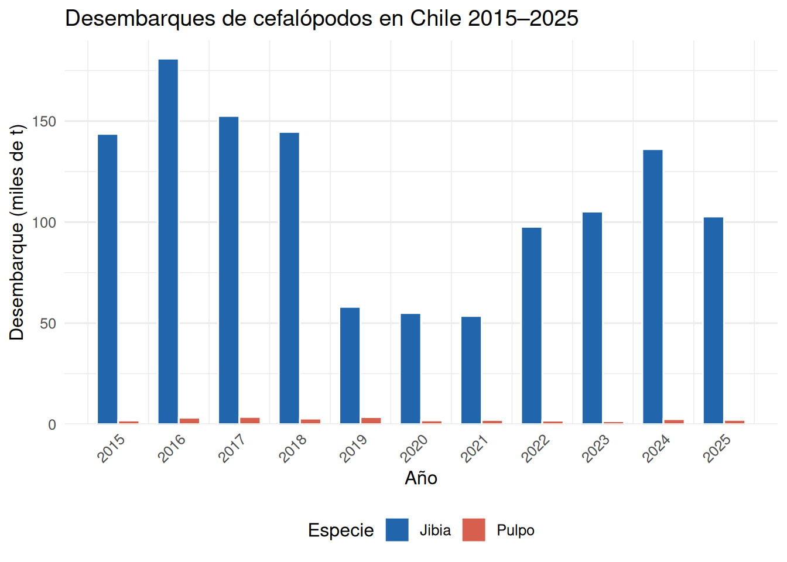

# Cefalópodos: Jibia y Pulpo Común {#cefalopodos}

Los cefalópodos son moluscos altamente evolucionados que carecen de concha externa y presentan tentáculos alrededor de la boca. Son depredadores activos con sistemas nerviosos complejos y capacidad de cambio rápido de coloración. En Chile, los recursos pesqueros más importantes de este grupo son la **jibia** (*Dosidicus gigas*) y el **pulpo común** (*Octopus mimus*).

## Jibia o Pota (*Dosidicus gigas*) {#jibia}

### Taxonomía y distribución

La jibia —también llamada pota o calamar de Humboldt— pertenece al orden Teuthida, familia Ommastrephidae. Es el calamar de mayor talla que habita el océano Pacífico oriental, con distribución desde Baja California (México) hasta las costas de Chile central (~45°S), extendiéndose en sentido transversal hasta las islas Galápagos e Hawái.

### Morfología y tallas

El cuerpo (manto) es alargado y musculoso, con dos aletas romboidales en el extremo posterior. La coloración varía de rojizo-café a plateado dependiendo del estado de excitación. Posee 8 brazos y 2 tentáculos con ventosas dentadas que le permiten aferrar presas con eficacia.

En Chile se reconocen **tres grupos de talla** con características ecológicas diferenciadas:

- **Grupo pequeño** (<45 cm LM): individuos inmaduros, abundantes en zonas costeras someras.
- **Grupo mediano** (45–60 cm LM): predomina en la pesquería artesanal costera.
- **Grupo grande** (>60 cm LM): individuos adultos de mayor edad; dominan en captura industrial.

El crecimiento sigue una función sigmoidal (logística o de von Bertalanffy con fase de aceleración), reflejando la aceleración del crecimiento en fases tempranas y su desaceleración hacia la talla asintótica. Goicochea-Vigo et al. (2019) estimaron para la población peruana parámetros de crecimiento diferenciados por sexo (modelo de Schnute para hembras: $L_\infty$ = 106,96 cm LM; modelo de Gompertz para machos: $L_\infty$ = 127,58 cm LM).

### Biología reproductiva

*Dosidicus gigas* es una especie **semélpara**: los adultos mueren después de reproducirse. Las hembras producen masas de huevos gelatinosas que flotan en aguas superficiales. La fecundidad es muy elevada (~32 millones de huevos por hembra), lo que confiere alta resiliencia poblacional. La madurez sexual y el tamaño de maduración varían entre grupos de talla, lo que se interpreta como **plasticidad fenotípica** en respuesta a condiciones oceanográficas cambiantes.

### Alimentación

La jibia es un depredador oportunista y voraz. Su dieta incluye peces mesopelágicos (mictófidos, engráulidos), crustáceos (eufáusidos) y otros cefalópodos, incluida la propia especie (canibalismo registrado). Esta posición en la cadena trófica la hace sensible a cambios en la disponibilidad de presas pelágicas.

### Comportamiento migratorio y asociación con la ZMO

Una de las características más relevantes de *D. gigas* es su migración vertical diaria (**DVM**, *diel vertical migration*): durante el día desciende a profundidades superiores a 250 m, dentro de la **Zona de Mínimo de Oxígeno** (ZMO, <0,5 mL O₂/L), donde permanece en estado de baja actividad metabólica; durante la noche asciende a aguas superficiales (<100 m) para alimentarse (Gilly et al., 2006). Esta asociación con la ZMO otorga refugio frente a depredadores que no toleran la hipoxia.

Los estudios de telemetría electrónica (archivos de temperatura-profundidad) muestran que individuos equipados con marcas satelitales pueden desplazarse hasta **~30 km por día** en dirección horizontal, recorriendo cientos de kilómetros en semanas (Gilly et al., 2006).

### Longevidad y dinámica poblacional

*Dosidicus gigas* tiene una vida corta de aproximadamente **1 a 1,5 años**. La renovación poblacional es rápida y la biomasa puede fluctuar considerablemente entre años dependiendo de las condiciones del ENSO y la intensidad de la ZMO. En años de El Niño, la reducción de la ZMO puede expandir el hábitat disponible y modificar los patrones migratorios.

## Pulpo Común (*Octopus mimus*) {#pulpo}

### Taxonomía y distribución

El pulpo común del Pacífico suroriental pertenece al orden Octopoda, familia Octopodidae. Su distribución abarca las costas de Perú y el norte de Chile (Regiones de Arica y Parinacota, Tarapacá, Antofagasta), con extensiones ocasionales hasta la Región de Atacama.

### Morfología y dimorfismo sexual

El cuerpo es redondeado y flexible, sin concha interna salvo restos vestigiales. Los ocho tentáculos están equipados con ventosas para capturar presas. La especie es **dioica** (sexos separados) y presenta notable **dimorfismo sexual**: los machos poseen un brazo hectocotilizado (tercer brazo derecho modificado) para la transferencia de espermatóforos a la hembra.

### Biología reproductiva y reclutamiento

La reproducción ocurre principalmente en **primavera-verano** (octubre a marzo). Las hembras ponen racimos de huevos en cuevas o grietas, cuidándolos durante varias semanas hasta la eclosión (comportamiento de incubación). A diferencia de otras especies, *O. mimus* presenta **reclutamiento continuo** a lo largo del año, aunque con mayor intensidad en los meses cálidos. Tras el desove, las hembras mueren (semelparidad).

Los estudios genéticos revelan **baja diversidad haplotípica** en poblaciones chileno-peruanas, consistente con una expansión post-glacial reciente desde un refugio único durante el Último Máximo Glacial (~18.000 años AP).

### Crecimiento

El crecimiento de *O. mimus* es rápido en condiciones favorables. La talla comercial se alcanza en aproximadamente 6–12 meses dependiendo de la temperatura del agua. En el norte de Chile, la pesca artesanal opera principalmente sobre individuos de peso entre 0,5 y 3 kg (peso entero).

### Alimentación

Es un depredador de emboscada que se alimenta fundamentalmente de crustáceos (jaibas, cangrejos) y moluscos bivalvos, inyectando saliva tóxica para paralizar a sus presas.

## Pesquerías chilenas de cefalópodos {#pesca-cefalopodos}

### Jibia

La pesquería de jibia en Chile se inició de manera significativa a comienzos de la década de 2000, consolidándose como una de las pesquerías de mayor volumen del país a partir de 2004. Opera principalmente con poteras artesanales e industriales en las regiones de Atacama, Coquimbo, Valparaíso y el Biobío. Los desembarques muestran alta variabilidad interanual, con máximos históricos cercanos a las 200.000 toneladas y descensos marcados en años de El Niño (Tabla \@ref(tab:tab-desembarques-cef), Figura \@ref(fig:fig-desembarques-cef)).

### Pulpo

La pesquería de pulpo es predominantemente artesanal y se concentra en el norte de Chile (Regiones XV, I y II). Los desembarques son significativamente menores que los de jibia y presentan también variabilidad interanual asociada a condiciones oceanográficas y esfuerzo pesquero.

(\#fig:fig-desembarques-cef)Desembarques de jibia (*Dosidicus gigas*) y pulpo (*Octopus mimus*) en Chile entre 2015 y 2025. Fuente: SERNAPESCA (2025).

<table class="table table-striped table-hover" style="width: auto !important; margin-left: auto; margin-right: auto;">
<caption>(\#tab:tab-desembarques-cef)Desembarques anuales (toneladas) de jibia y pulpo en Chile, 2015–2025. Fuente: SERNAPESCA (2025).</caption>
 <thead>
  <tr>
   <th style="text-align:center;"> Año </th>
   <th style="text-align:right;"> Jibia (t) </th>
   <th style="text-align:right;"> Pulpo (t) </th>
  </tr>
 </thead>
<tbody>
  <tr>
   <td style="text-align:center;font-weight: bold;"> 2015 </td>
   <td style="text-align:right;"> 143.684 </td>
   <td style="text-align:right;"> 1.849 </td>
  </tr>
  <tr>
   <td style="text-align:center;font-weight: bold;"> 2016 </td>
   <td style="text-align:right;"> 180.914 </td>
   <td style="text-align:right;"> 3.215 </td>
  </tr>
  <tr>
   <td style="text-align:center;font-weight: bold;"> 2017 </td>
   <td style="text-align:right;"> 152.537 </td>
   <td style="text-align:right;"> 3.602 </td>
  </tr>
  <tr>
   <td style="text-align:center;font-weight: bold;"> 2018 </td>
   <td style="text-align:right;"> 144.646 </td>
   <td style="text-align:right;"> 2.780 </td>
  </tr>
  <tr>
   <td style="text-align:center;font-weight: bold;"> 2019 </td>
   <td style="text-align:right;"> 58.071 </td>
   <td style="text-align:right;"> 3.533 </td>
  </tr>
  <tr>
   <td style="text-align:center;font-weight: bold;"> 2020 </td>
   <td style="text-align:right;"> 55.006 </td>
   <td style="text-align:right;"> 1.888 </td>
  </tr>
  <tr>
   <td style="text-align:center;font-weight: bold;"> 2021 </td>
   <td style="text-align:right;"> 53.569 </td>
   <td style="text-align:right;"> 2.089 </td>
  </tr>
  <tr>
   <td style="text-align:center;font-weight: bold;"> 2022 </td>
   <td style="text-align:right;"> 97.687 </td>
   <td style="text-align:right;"> 1.765 </td>
  </tr>
  <tr>
   <td style="text-align:center;font-weight: bold;"> 2023 </td>
   <td style="text-align:right;"> 105.202 </td>
   <td style="text-align:right;"> 1.502 </td>
  </tr>
  <tr>
   <td style="text-align:center;font-weight: bold;"> 2024 </td>
   <td style="text-align:right;"> 136.133 </td>
   <td style="text-align:right;"> 2.511 </td>
  </tr>
  <tr>
   <td style="text-align:center;font-weight: bold;"> 2025 </td>
   <td style="text-align:right;"> 102.779 </td>
   <td style="text-align:right;"> 2.136 </td>
  </tr>
</tbody>
</table>

## Estado y evaluación de los recursos {#estado-cef}

### Jibia

*Dosidicus gigas* es manejada en Chile como recurso con acceso libre artesanal bajo la Ley General de Pesca y Acuicultura. Dada su corta longevidad y alta fecundidad, los modelos de evaluación convencionales (basados en cohortes) son difíciles de aplicar. Se utiliza principalmente análisis de captura por unidad de esfuerzo (CPUE) como indicador de abundancia relativa, junto con encuestas de evaluación directa en zonas clave. La variabilidad interanual de los desembarques refleja en gran medida fluctuaciones oceanográficas más que agotamiento pesquero.

### Pulpo

*Octopus mimus* está sujeto a vedas temporales regionales y tallas mínimas de extracción. El manejo se enfoca en proteger el período reproductivo estival y garantizar la renovación poblacional anual.

## Síntesis comparativa {#sintesis-cef}

<table class="table table-striped table-hover" style="margin-left: auto; margin-right: auto;">
<caption>(\#tab:tab-sintesis-cef)Comparación de atributos biológicos y pesqueros de jibia y pulpo común en Chile.</caption>
 <thead>
  <tr>
   <th style="text-align:left;"> Característica </th>
   <th style="text-align:left;"> Jibia </th>
   <th style="text-align:left;"> Pulpo </th>
  </tr>
 </thead>
<tbody>
  <tr>
   <td style="text-align:left;width: 3.5cm; font-weight: bold;"> Grupo taxonómico </td>
   <td style="text-align:left;width: 5cm; "> Teuthida (calamar) </td>
   <td style="text-align:left;width: 5cm; "> Octopoda (pulpo) </td>
  </tr>
  <tr>
   <td style="text-align:left;width: 3.5cm; font-weight: bold;"> Longevidad </td>
   <td style="text-align:left;width: 5cm; "> 1–1,5 años </td>
   <td style="text-align:left;width: 5cm; "> 1–2 años </td>
  </tr>
  <tr>
   <td style="text-align:left;width: 3.5cm; font-weight: bold;"> Reproducción </td>
   <td style="text-align:left;width: 5cm; "> Semélpara; ~32M huevos/hembra </td>
   <td style="text-align:left;width: 5cm; "> Semélpara; incubación materna </td>
  </tr>
  <tr>
   <td style="text-align:left;width: 3.5cm; font-weight: bold;"> Talla máxima </td>
   <td style="text-align:left;width: 5cm; "> &gt;100 cm LM </td>
   <td style="text-align:left;width: 5cm; "> ~3–5 kg peso entero </td>
  </tr>
  <tr>
   <td style="text-align:left;width: 3.5cm; font-weight: bold;"> Hábitat principal </td>
   <td style="text-align:left;width: 5cm; "> Pelágico oceánico; DVM &gt;250 m </td>
   <td style="text-align:left;width: 5cm; "> Bentónico costero </td>
  </tr>
  <tr>
   <td style="text-align:left;width: 3.5cm; font-weight: bold;"> Pesquería </td>
   <td style="text-align:left;width: 5cm; "> Industrial + artesanal; poteras </td>
   <td style="text-align:left;width: 5cm; "> Artesanal; trampas y buceo </td>
  </tr>
  <tr>
   <td style="text-align:left;width: 3.5cm; font-weight: bold;"> Estado </td>
   <td style="text-align:left;width: 5cm; "> Alta variabilidad; sin sobreexplotación evidente </td>
   <td style="text-align:left;width: 5cm; "> Veda reproductiva; talla mínima </td>
  </tr>
</tbody>
</table>

## Glosario {#glosario-cef}

**Cefalópodo**: molusco con tentáculos en la cabeza y sin concha externa; incluye calamares, sepias y pulpos.

**DVM** (*Diel Vertical Migration*): migración vertical diaria entre aguas profundas (día) y superficiales (noche), típica de muchos organismos marinos.

**Hectocotilo**: brazo modificado del pulpo macho utilizado para transferir espermatóforos.

**Longevidad semélpara**: estrategia vital en que los adultos se reproducen una sola vez y mueren poco después.

**Manto**: cavidad corporal de los moluscos cefalópodos; en calamares es alargado y musculoso.

**Plasticidad fenotípica**: capacidad de un genotipo de expresar diferentes fenotipos (talla, madurez, coloración) en respuesta al ambiente.

**Poteras**: artes de pesca de anzuelos múltiples sin carnada, usadas para capturar jibia y otros calamares.

**Semelparidad**: estrategia reproductiva de reproducción única seguida de la muerte del adulto.

**ZMO** (Zona de Mínimo de Oxígeno): capa oceánica de muy baja concentración de oxígeno disuelto (~200–800 m en el Pacífico oriental), usada por la jibia como refugio diurno.

**Fecundidad**: número de huevos producidos por una hembra durante su vida reproductiva.

**Dimorfismo sexual**: diferencias morfológicas entre machos y hembras de la misma especie.

**CPUE** (Captura por Unidad de Esfuerzo): indicador indirecto de abundancia relativa en pesquerías.

**Reclutamiento**: ingreso de individuos jóvenes a la fracción explotable de una población.

**Telemetría electrónica**: uso de dispositivos electrónicos (marcas archivadoras o de satélite) para registrar posición, profundidad y temperatura de animales en el mar.

## Preguntas de autoevaluación {#preguntas-cef}

### Nivel básico — comprensión

1. ¿A qué clase de moluscos pertenecen la jibia y el pulpo? Mencione dos características morfológicas que los distingan de otros moluscos.

2. ¿Qué es la migración vertical diaria (DVM) de *Dosidicus gigas* y qué ventaja ecológica le otorga?

3. Describa el comportamiento reproductivo de *Octopus mimus* e indique en qué estación del año ocurre con mayor intensidad.

### Nivel intermedio — análisis

4. Los desembarques de jibia en Chile presentan alta variabilidad interanual. Proponga dos hipótesis —una de origen oceanográfico y otra de origen pesquero— que podrían explicar esta variabilidad.

5. ¿Por qué los modelos de evaluación de stock convencionales (basados en estructura de edades) son difíciles de aplicar a *Dosidicus gigas*? ¿Qué método alternativo se utiliza?

6. Compare la estrategia reproductiva de *Dosidicus gigas* y *Octopus mimus*. ¿En qué difieren en cuanto a cuidado parental y fecundidad?

### Nivel avanzado — síntesis y aplicación

7. La baja diversidad haplotípica de *Octopus mimus* en el norte de Chile se ha relacionado con una expansión post-glacial. ¿Qué implicaciones tiene este hallazgo para la definición de unidades de manejo de la especie?

8. ¿Cómo afectaría un evento de El Niño intenso a la distribución vertical de *Dosidicus gigas* y a su pesquería? Fundamente con base en la relación entre la ZMO y el comportamiento de la especie.

9. Analice la Figura de desembarques y proponga un índice de referencia simple (umbral de captura) que podría usarse como precautorio para la jibia chilena, justificando su elección.

## Referencias {#refs-cef}

Gilly, W. F., Markaida, U., Baxter, C. H., Block, B. A., Boustany, A., Zeidberg, L., … Salinas, C. (2006). Vertical and horizontal migrations by the jumbo squid *Dosidicus gigas* revealed by electronic tagging. *Marine Ecology Progress Series*, **324**, 1–17. https://doi.org/10.3354/meps324001

Keyl, F., Argüelles, J., Mariátegui, L., Tafur, R., Wolff, M., & Yamashiro, C. (2008). A hypothesis on range expansion and spatio-temporal shifts in size-at-maturity of jumbo squid (*Dosidicus gigas*) in the Eastern Pacific Ocean. *CalCOFI Reports*, **49**, 119–128.

Markaida, U., & Sosa-Nishizaki, O. (2003). Food and feeding habits of jumbo squid *Dosidicus gigas* (Cephalopoda: Ommastrephidae) from the Gulf of California, Mexico. *Journal of the Marine Biological Association of the United Kingdom*, **83**(3), 507–522.

SERNAPESCA (2025). *Anuario Estadístico de Pesca 2025. Series 2015–2025*. Servicio Nacional de Pesca y Acuicultura, Valparaíso, Chile.

