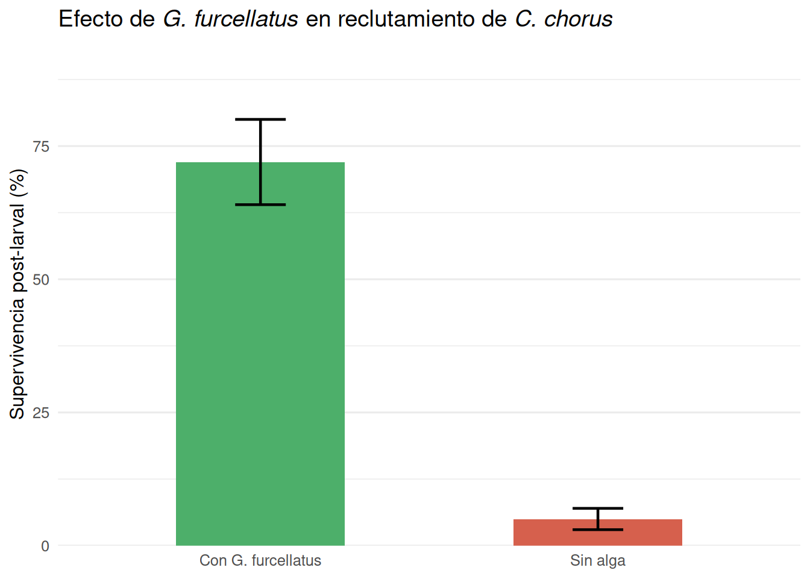
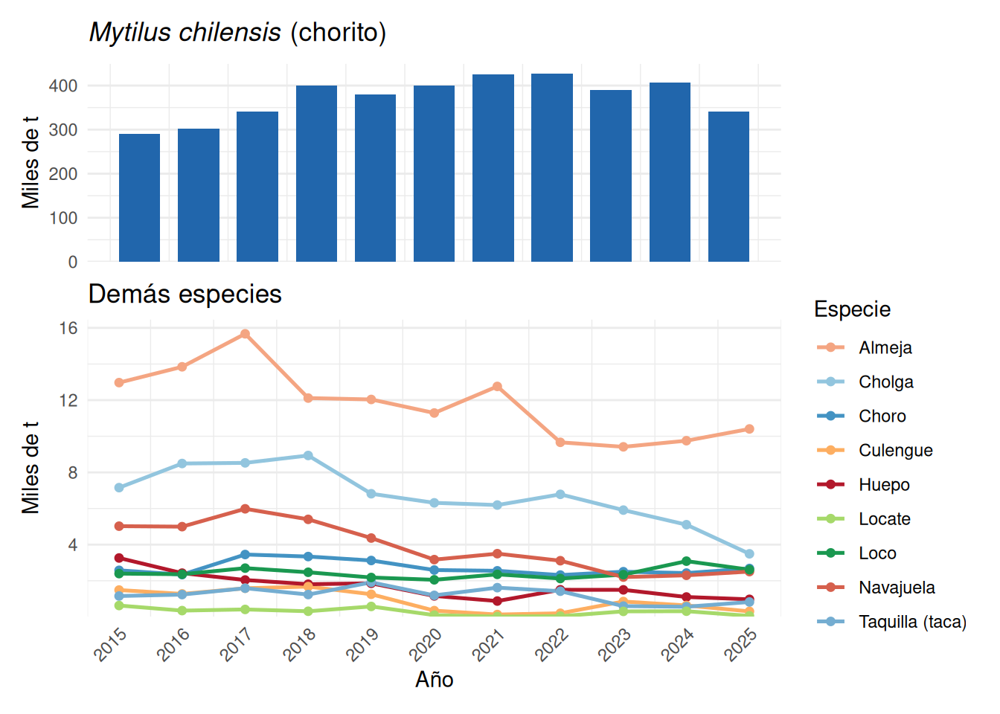

# Moluscos Bivalvos y Gastrópodos {#bivalvos-gastropodos}

Los moluscos representan el segundo grupo más grande de animales en las costas chilenas, con aproximadamente 230 especies de bivalvos distribuidas en 51 familias. Son componentes clave de las pesquerías bentónicas y de la acuicultura nacional: en 2021, los moluscos aportaron más de 520.000 toneladas al desembarque total chileno, siendo el **chorito** (*Mytilus chilensis*) el recurso dominante con ~82% del volumen. La clase Bivalvia y la clase Gastropoda incluyen especies de importancia ecológica, cultural y económica que van desde mitílidos de cultivo hasta gastrópodos de crecimiento lento gestionados en Áreas de Manejo.

## Bivalvos {#bivalvos}

Los bivalvos son moluscos con el cuerpo comprimido lateralmente y protegido por dos valvas unidas por una charnela y un ligamento elástico. Sus branquias (*ctenidios*) son órganos altamente desarrollados que cumplen función respiratoria y de filtración: corrientes ciliares conducen partículas alimenticias (fitoplancton, materia orgánica) hacia la boca. Carecen de cabeza definida y su locomoción depende del pie muscular.

### Familia Mytilidae — Choritos, Choro zapato y Cholga {#mytilidae}

Los mitílidos forman densos bancos desde el intermareal hasta ~25 m de profundidad, sobre sustratos duros o blandos con subfondo sólido. Son organismos euritermos y eurihalinos que toleran amplios rangos de temperatura y salinidad, atributo esencial para la mitilicultura en los canales y fiordos del sur de Chile.

#### Ciclo de vida

Son dioicos con fecundación externa masiva en la columna de agua. La larva pelágica (trocófera → veliger → umbo) deriva durante 20–25 días antes de fijarse al sustrato como postlarva mediante hilos del biso. El éxito del reclutamiento depende de la disponibilidad de sustrato y de la rugosidad de la superficie.

#### Mytilus chilensis — Chorito

*Mytilus chilensis* (Hupé, 1854) es el mitílido de mayor importancia pesquera y acuícola de Chile. Se distribuye entre la Región de Los Ríos y Magallanes, con núcleo productivo en los canales de Chiloé, Aysén y la zona de Calbuco. Su crecimiento es rápido en aguas frías y productivas: puede alcanzar tallas comerciales (≥6 cm) en 12–18 meses en sistemas de cultivo suspendido (long line).

**Sistema de cultivo**: La mitilicultura chilena opera con el sistema *long line* (cabos colectores suspendidos de líneas flotantes). Las principales etapas son: (1) captación de semilla natural en colectores artificiales (cuerdas de polipropileno), (2) desdoble y resiembra en cuerdas de cultivo, y (3) cosecha con canastas o cuerdas al alcanzar la talla comercial. Los centros productivos se concentran entre Puerto Montt y la Isla Grande de Chiloé.

#### Hipótesis de cambio climático sobre captación de semillas

Investigaciones recientes (Molinet et al., 2021, 2025) plantean que el calentamiento oceánico y el aumento de salinidad en los fiordos patagónicos —producto de la reducción del derretimiento glaciar— podrían alterar el transporte larval y reducir el éxito de captación de semillas en colectores artificiales. La hipótesis central señala que:

- La estratificación halocional de los fiordos actúa como barrera para el transporte de larvas desde áreas de desove hacia las zonas de captación.
- El aumento de temperatura superficial puede acelerar la metamorfosis larval, reduciendo la ventana de captación.
- La proliferación de floraciones algales nocivas (FAN), favorecida por condiciones más cálidas y estratificadas, puede causar mortalidad larval masiva.
- La sobreexplotación de semilla silvestre en bancos naturales reduce el stock reproductor que aporta larvas al sistema, lo que, sumado a los cambios en los aportes de agua dulce a los fiordos, podría comprometer el abastecimiento de semilla para la mitilicultura (Molinet et al., 2025).

Estas proyecciones tienen implicaciones directas para la sustentabilidad de la mitilicultura en el sur de Chile, que depende en un porcentaje significativo de semilla silvestre.

#### Choromytilus chorus — Choro zapato

*Choromytilus chorus* es el mitílido más grande de Chile, con tallas que pueden superar los 20 cm. Se distribuye desde Arica hasta Chiloé en el submareal rocoso (2–20 m). Presenta una **interacción ecológica notable** con el alga roja *Gymnogongrus furcellatus*: el reclutamiento del choro zapato solo tiene éxito cuando las postlarvas se fijan en el tapete que forma este alga, el cual les proporciona refugio físico contra la depredación por gasterópodos durante las etapas más vulnerables. Sin la cobertura del alga, la mortalidad post-asentamiento puede ser casi total (Figura \@ref(fig:fig-interaccion-alga)).

(\#fig:fig-interaccion-alga)Relación entre el alga roja *Gymnogongrus furcellatus* y el reclutamiento de *Choromytilus chorus* (choro zapato). El alga actúa como sustrato protector: la supervivencia post-larval es significativamente mayor en parches con cobertura algal que en sustrato desnudo (basado en literatura revisada).

Desde el punto de vista pesquero, el choro zapato es explotado artesanalmente mediante buceo en el centro y norte de Chile. La estructura espacial de sus poblaciones es de tipo **metapoblación**: los bancos locales son mantenidos por conectividad larval entre parches a través de corrientes costeras, lo que justifica la necesidad de conservar bancos reproductores aún en localidades de baja densidad.

#### Aulacomya ater — Cholga

La cholga se distribuye desde Coquimbo hasta Magallanes y es el mitílido más importante de la Patagonia chilena, tanto en acuicultura como en pesquería artesanal. Comparte hábitat con el choro zapato, con el cual mantiene una relación de **competencia por el espacio**: *Choromytilus chorus* tiende a desplazar a *Aulacomya ater* en el submareal somero de la zona norte, donde las temperaturas son más elevadas. En el sur de Chile, la cholga predomina en fondos de mayor profundidad y exposición al oleaje.

### Navajuela y Huepo — Tagelus dombeii y Ensis macha {#navajuelas}

#### Tagelus dombeii — Navajuela

*Tagelus dombeii* (Lamarck, 1818) es un bivalvo infaunal de la familia Solecurtidae que habita fondos arenosos y fango-arenosos del submareal (0–20 m). Se distribuye desde el norte de Chile hasta Chiloé, con mayor abundancia en el Golfo de Arauco, la zona de Llico y Corral. Su concha es elongada, frágil y de color café-verdoso. La extracción se realiza con herramientas manuales (barretillas) durante mareas bajas o con dragas artesanales.

La pesquería de navajuela es una de las más importantes del bentos de la zona centro-sur: en su máximo (2017) superó las 5.900 toneladas anuales. Los desembarques han mostrado tendencia decreciente desde 2018, asociada a sobreexplotación de bancos costeros y variabilidad ambiental.

#### Ensis macha — Huepo o Navaja de Mar

*Ensis macha* (Molina, 1782) (familia Pharidae) es el huepo o navaja de mar, bivalvo infaunal de mayor talla que la navajuela, reconocible por su concha elongada (>20 cm), delgada y brillante. Habita enterrado en sedimentos arenosos del submareal (0–15 m), del que puede emerger usando su robusto pie muscular. Sus sifones largos le permiten filtrar desde la columna de agua sin abandonar el sedimento.

Las pesquerías de huepo se localizan principalmente en el **Golfo del Arauco**, la zona de **Corral**, la **Bahía de Ancud** y la Región de **Magallanes**. La extracción es artesanal por buceo y marisqueo en playa. Los desembarques nacionales mostraron una baja sostenida entre 2015 y 2021 (3.260 → 876 t), con recuperación parcial posterior.

### Venus antiqua — Almeja {#almeja}

*Venus antiqua* (King & Broderip, 1832), comúnmente llamada almeja, pertenece a la familia Veneridae. Se distribuye desde el norte de Chile hasta Tierra del Fuego, con especial importancia pesquera y cultural en la **zona de Ancud** (Isla Grande de Chiloé), donde es un recurso emblemático de la gastronomía local y la pesca artesanal.

Habita enterrada en fondos areno-fangosos de bahías semi-protegidas, desde la zona intermareal inferior hasta ~15 m de profundidad. Alcanza la talla mínima legal (5 cm de longitud valvar) en aproximadamente 2–3 años. Su ciclo reproductivo presenta dos picos de evacuación de gametos al año (primavera y otoño). La almeja es también objeto de cultivo experimental en la zona de Los Lagos.

En términos de desembarque, la almeja ha sido históricamente uno de los recursos bivalvos más importantes de Chile, con volúmenes entre 9.000 y 16.000 toneladas anuales en el período 2015–2025.

### Gari solida — Culengue {#culengue}

*Gari solida* (Gray, 1828), familia Psammobiidae, es conocida como culengue en Chile. Se distribuye desde Arica hasta Chiloé, con mayor abundancia en la zona norte (Regiones XV a IV). Habita fondos arenosos semi-expuestos del intermareal y submareal somero (0–10 m). Su concha es redondeada, de color rosado o blanco con marcas radiales.

La biología reproductiva de *G. solida* muestra un ciclo continuo con mayor actividad gonadal entre primavera y verano (noviembre–marzo). El crecimiento es moderado, con tallas máximas de ~7 cm en 3–4 años, aunque con variabilidad entre localidades que sugiere la existencia de stocks locales diferenciados. Los desembarques mostraron una caída drástica entre 2019 y 2021 (1.252 → 129 t), con incipiente recuperación posterior.

### Protothaca thaca — Taca {#taca}

*Protothaca thaca* (Molina, 1782), familia Veneridae, es la taca o taquilla, uno de los recursos bivalvos más relevantes de la **zona norte de Chile** (Regiones XV, I y II). Se distribuye desde Perú hasta la Región de Coquimbo, habitando fondos areno-fangosos en bahías protegidas del submareal (0–15 m). Su concha es robusta, ovalada, de color blanco-cremoso con tenues radios o manchas.

La pesquería de taca es artesanal y de gran importancia socioeconómica en el norte. Los principales focos de extracción son las bahías de Arica, Iquique y Antofagasta. Los estudios de crecimiento muestran variabilidad espacial notable entre bancos del norte y el centro, indicando que cada bahía puede constituir una unidad de stock relativamente independiente, con parámetros de von Bertalanffy distintos.

Los ciclos reproductivos son continuos durante el año, con desoves principales en **febrero** y entre **mayo–junio**. La talla de primera madurez es ~2,5 cm. Su gestión se realiza parcialmente mediante Áreas de Manejo (AMERB), aunque también existe extracción de libre acceso.

Nota: en la estadística oficial de SERNAPESCA aparece como TAQUILLA; en la tabla de la figura \@ref(fig:fig-desem-biv) se combina bajo esa denominación.

## Gastrópodos {#gastropodos}

Los gastrópodos son el grupo más diverso de los moluscos chilenos. A diferencia de los bivalvos filtradores, los gastrópodos de importancia pesquera son principalmente herbívoros o depredadores, con ciclos de vida más lentos y mayor vulnerabilidad a la sobreexplotación.

### Concholepas concholepas — Loco {#loco}

*Concholepas concholepas* (Bruguière, 1789), familia Muricidae, es el gastrópodo más emblemático y económicamente importante de Chile. Se distribuye desde **Perú** hasta el **Cabo de Hornos**, en fondos rocosos del submareal (superficie a 50 m de profundidad).

#### Morfología y comportamiento

Su concha es gruesa e irregular, con espira muy baja y una gran abertura oval que representa casi toda la concha. El pie muscular le permite adherirse fuertemente al sustrato rocoso. Es un **depredador nocturno** que se alimenta principalmente de mitílidos (*Aulacomya ater*, *Choromytilus chorus*), picorocos (*Balanus* spp.), almejas y tunicados. Durante el día permanece refugiado en grietas.

#### Ciclo de vida

Es dioico con **fecundación interna**. Las hembras depositan los embriones en cápsulas adheridas a la roca, de las cuales emergen larvas veliger (~1,5 mm) que ingresan al plancton durante 3–4 semanas. El **asentamiento** ocurre a 1,6–1,8 mm de talla, cuando la larva metamorfosea y se posa en el fondo. El **reclutamiento** —ingreso efectivo a la población bentónica juvenil— depende de condiciones locales de sustrato, depredación y alimento.

#### Crecimiento y talla mínima legal

El crecimiento es lento: entre **1 y 3 mm por mes**, por lo que un individuo tarda entre 4,6 y 6 años en alcanzar la **talla mínima legal de 10 cm** de longitud total. Esta característica lo hace altamente vulnerable a la sobreexplotación y de difícil recuperación una vez que las poblaciones colapsan.

#### Gestión — Áreas de Manejo (AMERB)

Dado su lento crecimiento y su alto valor comercial, el loco fue objeto de una sobreexplotación masiva en las décadas de 1970–1980, que llevó a la implementación de **vedas y cuotas** a partir de 1989. El instrumento central de gestión actual son las **Áreas de Manejo y Explotación de Recursos Bentónicos (AMERB)**, establecidas por la Ley de Pesca en 1991. Cada AMERB es concesionada a una organización de pescadores artesanales, que tiene derechos exclusivos de explotación a cambio de monitorear el recurso y cumplir planes de manejo basados en evaluaciones periódicas. Este sistema ha demostrado efectividad para la recuperación local de poblaciones de loco en zonas donde se implementa correctamente.

Los desembarques de loco se han mantenido relativamente estables entre 2.000 y 3.000 toneladas anuales en el período 2015–2025, reflejando el control ejercido por el sistema de AMERB.

### Thais chocolata — Locate {#locate}

*Thais chocolata* (Duclos, 1832), familia Muricidae, es el caracol locate, principal gastrópodo de pesca artesanal en el **norte de Chile**. Se distribuye desde **Paita (Perú) hasta Valparaíso**, con las mayores biomasas entre Arica y Antofagasta, donde habita fondos rocosos y de conchuela en el submareal somero.

La característica más llamativa de su biología reproductiva es la formación de grandes **agregaciones reproductivas** denominadas "*maicillo*", en las que cientos de individuos se concentran para el desove. Estas agregaciones ocurren principalmente en primavera-verano y representan una fase de alta vulnerabilidad para la población, ya que los pescadores las localizan fácilmente.

Parámetros biológicos: talla máxima 88–100 mm; talla modal en capturas 50–55 mm; primera madurez a ~40 mm. Se han identificado al menos dos períodos reproductivos al año. Su dinámica poblacional es aún poco estudiada, lo que dificulta establecer puntos de referencia biológicos para su manejo.

Los desembarques de locate (registrado como "Caracol Locate" en SERNAPESCA) muestran alta variabilidad interanual, con máximos de ~628 t (2015) y mínimos de 17 t (2021).

### Navajuela gastrópodo y recursos menores

Además del locate, en las costas chilenas se explotan otros gastrópodos como la **navajuela** (gastrópodo del género *Tegula*), el **caracol trophon** (*Trophon geversianus*) en Magallanes —que forma agregaciones en bahías protegidas y alcanza la talla comercial (6 cm) en 3–4 años—, y diversas especies del género **Fissurella** (lapas), cuyo complejo multiespecífico de 13 especies en Chile presenta desafíos de gestión porque los desembarques se registran en su mayor parte sin diferenciación por especie.

## Desembarques 2015–2025 {#desem-bivalvos}

(\#fig:fig-desem-biv)Desembarques (toneladas) de principales bivalvos y gastrópodos en Chile, 2015–2025. Nótese la escala diferencial: el chorito domina en volumen mientras que los demás recursos se presentan en la figura inferior con escala reducida. Fuente: SERNAPESCA (2025).

<table class="table table-striped table-hover" style="width: auto !important; margin-left: auto; margin-right: auto;">
<caption>(\#tab:tab-desem-biv)Estadística descriptiva de desembarques (2015–2025) de los principales bivalvos y gastrópodos de Chile. Fuente: SERNAPESCA (2025).</caption>
 <thead>
  <tr>
   <th style="text-align:left;"> Especie </th>
   <th style="text-align:left;"> Grupo </th>
   <th style="text-align:right;"> Media (t) </th>
   <th style="text-align:right;"> Mín. (t) </th>
   <th style="text-align:right;"> Máx. (t) </th>
  </tr>
 </thead>
<tbody>
  <tr grouplength="8"><td colspan="5" style="border-bottom: 1px solid;"><strong>Bivalvos</strong></td></tr>
<tr>
   <td style="text-align:left;padding-left: 2em;font-style: italic;" indentlevel="1"> Chorito </td>
   <td style="text-align:left;"> Bivalvos </td>
   <td style="text-align:right;"> 373.302 </td>
   <td style="text-align:right;"> 290.291 </td>
   <td style="text-align:right;"> 427.884 </td>
  </tr>
  <tr>
   <td style="text-align:left;padding-left: 2em;font-style: italic;" indentlevel="1"> Almeja </td>
   <td style="text-align:left;"> Bivalvos </td>
   <td style="text-align:right;"> 11.811 </td>
   <td style="text-align:right;"> 9.414 </td>
   <td style="text-align:right;"> 15.672 </td>
  </tr>
  <tr>
   <td style="text-align:left;padding-left: 2em;font-style: italic;" indentlevel="1"> Cholga </td>
   <td style="text-align:left;"> Bivalvos </td>
   <td style="text-align:right;"> 6.702 </td>
   <td style="text-align:right;"> 3.491 </td>
   <td style="text-align:right;"> 8.935 </td>
  </tr>
  <tr>
   <td style="text-align:left;padding-left: 2em;font-style: italic;" indentlevel="1"> Navajuela </td>
   <td style="text-align:left;"> Bivalvos </td>
   <td style="text-align:right;"> 3.868 </td>
   <td style="text-align:right;"> 2.203 </td>
   <td style="text-align:right;"> 5.983 </td>
  </tr>
  <tr>
   <td style="text-align:left;padding-left: 2em;font-style: italic;" indentlevel="1"> Choro </td>
   <td style="text-align:left;"> Bivalvos </td>
   <td style="text-align:right;"> 2.717 </td>
   <td style="text-align:right;"> 2.315 </td>
   <td style="text-align:right;"> 3.452 </td>
  </tr>
  <tr>
   <td style="text-align:left;padding-left: 2em;font-style: italic;" indentlevel="1"> Huepo </td>
   <td style="text-align:left;"> Bivalvos </td>
   <td style="text-align:right;"> 1.681 </td>
   <td style="text-align:right;"> 876 </td>
   <td style="text-align:right;"> 3.260 </td>
  </tr>
  <tr>
   <td style="text-align:left;padding-left: 2em;font-style: italic;" indentlevel="1"> Taquilla (taca) </td>
   <td style="text-align:left;"> Bivalvos </td>
   <td style="text-align:right;"> 1.212 </td>
   <td style="text-align:right;"> 561 </td>
   <td style="text-align:right;"> 1.912 </td>
  </tr>
  <tr>
   <td style="text-align:left;padding-left: 2em;font-style: italic;" indentlevel="1"> Culengue </td>
   <td style="text-align:left;"> Bivalvos </td>
   <td style="text-align:right;"> 885 </td>
   <td style="text-align:right;"> 129 </td>
   <td style="text-align:right;"> 1.676 </td>
  </tr>
  <tr grouplength="2"><td colspan="5" style="border-bottom: 1px solid;"><strong>Gastrópodos</strong></td></tr>
<tr>
   <td style="text-align:left;padding-left: 2em;font-style: italic;" indentlevel="1"> Loco </td>
   <td style="text-align:left;"> Gastrópodos </td>
   <td style="text-align:right;"> 2.424 </td>
   <td style="text-align:right;"> 2.052 </td>
   <td style="text-align:right;"> 3.085 </td>
  </tr>
  <tr>
   <td style="text-align:left;padding-left: 2em;font-style: italic;" indentlevel="1"> Locate </td>
   <td style="text-align:left;"> Gastrópodos </td>
   <td style="text-align:right;"> 282 </td>
   <td style="text-align:right;"> 17 </td>
   <td style="text-align:right;"> 628 </td>
  </tr>
</tbody>
</table>

## Síntesis comparativa {#sintesis-biv}

<table class="table table-striped table-hover" style="margin-left: auto; margin-right: auto;">
<caption>(\#tab:tab-sintesis-biv)Características principales de los recursos de bivalvos y gastrópodos analizados en este capítulo.</caption>
 <thead>
  <tr>
   <th style="text-align:left;"> Especie </th>
   <th style="text-align:left;"> Nombre común </th>
   <th style="text-align:left;"> Zona principal </th>
   <th style="text-align:left;"> Hábitat </th>
   <th style="text-align:left;"> Pesquería </th>
  </tr>
 </thead>
<tbody>
  <tr grouplength="8"><td colspan="5" style="border-bottom: 1px solid;"><strong>Bivalvos</strong></td></tr>
<tr>
   <td style="text-align:left;padding-left: 2em;" indentlevel="1"> *Mytilus chilensis* </td>
   <td style="text-align:left;"> Chorito </td>
   <td style="text-align:left;"> Sur-Austral </td>
   <td style="text-align:left;"> Pelágico/Cultivo </td>
   <td style="text-align:left;"> Acuicultura </td>
  </tr>
  <tr>
   <td style="text-align:left;padding-left: 2em;" indentlevel="1"> *Choromytilus chorus* </td>
   <td style="text-align:left;"> Choro zapato </td>
   <td style="text-align:left;"> Norte-Centro </td>
   <td style="text-align:left;"> Submareal rocoso </td>
   <td style="text-align:left;"> Artesanal/buceo </td>
  </tr>
  <tr>
   <td style="text-align:left;padding-left: 2em;" indentlevel="1"> *Aulacomya ater* </td>
   <td style="text-align:left;"> Cholga </td>
   <td style="text-align:left;"> Centro-Sur </td>
   <td style="text-align:left;"> Submareal </td>
   <td style="text-align:left;"> Acuicultura/artesanal </td>
  </tr>
  <tr>
   <td style="text-align:left;padding-left: 2em;" indentlevel="1"> *Venus antiqua* </td>
   <td style="text-align:left;"> Almeja </td>
   <td style="text-align:left;"> Todo Chile </td>
   <td style="text-align:left;"> Infaunal areno-fangoso </td>
   <td style="text-align:left;"> Artesanal/buceo </td>
  </tr>
  <tr>
   <td style="text-align:left;padding-left: 2em;" indentlevel="1"> *Tagelus dombeii* </td>
   <td style="text-align:left;"> Navajuela </td>
   <td style="text-align:left;"> Centro-Sur </td>
   <td style="text-align:left;"> Infaunal arenoso </td>
   <td style="text-align:left;"> Artesanal/marisqueo </td>
  </tr>
  <tr>
   <td style="text-align:left;padding-left: 2em;" indentlevel="1"> *Ensis macha* </td>
   <td style="text-align:left;"> Huepo </td>
   <td style="text-align:left;"> Centro-Sur-Austral </td>
   <td style="text-align:left;"> Infaunal arenoso </td>
   <td style="text-align:left;"> Artesanal/buceo </td>
  </tr>
  <tr>
   <td style="text-align:left;padding-left: 2em;" indentlevel="1"> *Gari solida* </td>
   <td style="text-align:left;"> Culengue </td>
   <td style="text-align:left;"> Norte-Centro </td>
   <td style="text-align:left;"> Intermareal-Submareal </td>
   <td style="text-align:left;"> Artesanal/marisqueo </td>
  </tr>
  <tr>
   <td style="text-align:left;padding-left: 2em;" indentlevel="1"> *Protothaca thaca* </td>
   <td style="text-align:left;"> Taca </td>
   <td style="text-align:left;"> Norte </td>
   <td style="text-align:left;"> Infaunal areno-fangoso </td>
   <td style="text-align:left;"> Artesanal/AMERB </td>
  </tr>
  <tr grouplength="2"><td colspan="5" style="border-bottom: 1px solid;"><strong>Gastrópodos</strong></td></tr>
<tr>
   <td style="text-align:left;padding-left: 2em;" indentlevel="1"> *Concholepas concholepas* </td>
   <td style="text-align:left;"> Loco </td>
   <td style="text-align:left;"> Todo Chile </td>
   <td style="text-align:left;"> Submareal rocoso </td>
   <td style="text-align:left;"> AMERB </td>
  </tr>
  <tr>
   <td style="text-align:left;padding-left: 2em;" indentlevel="1"> *Thais chocolata* </td>
   <td style="text-align:left;"> Locate </td>
   <td style="text-align:left;"> Norte </td>
   <td style="text-align:left;"> Submareal rocoso </td>
   <td style="text-align:left;"> Artesanal </td>
  </tr>
</tbody>
</table>

## Glosario {#glosario-biv}

**Área de Manejo (AMERB)**: zona costera concesionada a una organización de pescadores artesanales para la explotación exclusiva y sustentable de recursos bentónicos bajo un plan de manejo aprobado.

**Biso**: haces de filamentos proteicos secretados por el pie del mitílido para adherirse al sustrato.

**Bivalvo**: molusco con cuerpo encerrado entre dos valvas calcáreas articuladas por una charnela.

**Ctenidio**: branquia de moluscos; en bivalvos actúa también como órgano filtrador de alimento.

**Dioico**: organismo con sexos separados en individuos distintos (macho y hembra).

**Fecundación interna/externa**: la fecundación interna (ej. loco) ocurre dentro del cuerpo de la hembra; la externa (ej. choritos) ocurre en la columna de agua.

**FAN**: Floración Algal Nociva; proliferación masiva de microalgas tóxicas que puede causar mortalidad de moluscos y toxicidad por consumo humano.

**Gastrópodo**: clase de moluscos generalmente con concha espiral, pie muscular y masa visceral torsionada.

**Infaunal**: organismo que vive enterrado en el sedimento.

**Long line**: sistema de cultivo de mitílidos con cuerdas colectoras suspendidas de líneas flotantes ancladas al fondo.

**Maicillo**: agregación reproductiva masiva de *Thais chocolata* (locate) con fines de desove.

**Metapoblación**: conjunto de subpoblaciones espacialmente separadas conectadas por flujo de individuos (dispersión larval).

**Periodo de veda**: período en que la extracción de un recurso está prohibida por ley, generalmente durante la reproducción.

**Reclutamiento**: proceso por el que individuos juveniles se incorporan a la fracción adulta o explotable de una población.

**Trocófera/veliger**: estadios larvales planctónicos de muchos moluscos, previos al asentamiento.

**von Bertalanffy**: modelo matemático ampliamente usado en biología pesquera para describir el crecimiento individual en longitud a lo largo del tiempo ($L_t = L_\infty (1 - e^{-K(t-t_0)})$).

## Preguntas de autoevaluación {#preguntas-biv}

### Nivel básico — comprensión

1. Describa el ciclo de vida de *Mytilus chilensis* (chorito) desde la fecundación hasta el asentamiento al sustrato. ¿Cuánto dura la fase pelágica?

2. ¿Por qué el alga roja *Gymnogongrus furcellatus* es fundamental para el reclutamiento del choro zapato (*Choromytilus chorus*)? Explique el mecanismo ecológico involucrado.

3. ¿Qué es una Área de Manejo (AMERB) y por qué fue creada en Chile? Mencione la especie cuya sobreexplotación motivó principalmente este instrumento de gestión.

4. Identifique dos diferencias entre la navajuela (*Tagelus dombeii*) y el huepo (*Ensis macha*) en cuanto a distribución geográfica y zonas de pesca.

### Nivel intermedio — análisis

5. Explique cómo el cambio climático podría afectar la captación de semillas de chorito en los fiordos patagónicos. Mencione al menos dos mecanismos propuestos.

6. Compare las estrategias reproductivas de *Mytilus chilensis* (bivalvo, fecundación externa) y *Concholepas concholepas* (gastrópodo, fecundación interna). ¿Cómo influyen estas diferencias en la vulnerabilidad de cada especie a la explotación?

7. Los desembarques de *Thais chocolata* (locate) muestran alta variabilidad interanual. Proponga dos hipótesis que expliquen este patrón, una de origen biológico y otra relacionada con el esfuerzo pesquero.

8. ¿Por qué la pesquería de *Protothaca thaca* (taca) en el norte de Chile requiere un manejo diferenciado por bahía? Fundamente con base en la biología de la especie.

### Nivel avanzado — síntesis y aplicación

9. Analice la importancia del concepto de "metapoblación" para el manejo de *Choromytilus chorus*. ¿Qué implicaciones tiene para el diseño de Áreas de Manejo en la zona norte de Chile?

10. A partir de los datos de desembarque presentados (2015–2025), identifique cuáles recursos muestran tendencias preocupantes desde el punto de vista pesquero y proponga un criterio de manejo precautorio para al menos uno de ellos.

## Referencias {#refs-biv}

Jerez, G., Ariz, L., & Melo, T. (2000). Evaluación del recurso taca (*Protothaca thaca*) en la I, II y III Regiones. *Informe Técnico IFOP*, Valparaíso.

Molinet, C., Astorga, M., Cares, L., Díaz, M., Hueicha, K., Marín, S., Matamala, T., & Soto, D. (2021). Vertical distribution patterns of larval supply and spatfall of three species of Mytilidae in a Chilean fjord used for mussel farming: Insights for mussel spatfall efficiency. *Aquaculture*, **535**, 736341. https://doi.org/10.1016/j.aquaculture.2021.736341

Molinet, C., Soto, D., León-Muñoz, J., et al. (2025). Climate-driven changes in freshwater inputs to a Northern Patagonia fjord and overfishing of wild mussel seed could threaten Chilean mussel farming. *Climatic Change*, **178**, 119. https://doi.org/10.1007/s10584-025-03956-x

Moreno, C. A., Sutherland, J. P., & Jara, H. F. (1984). Man as a predator in the intertidal zone of Southern Chile. *Oikos*, **42**(2), 155–160.

Navarrete, S. A., & Castilla, J. C. (1990). Barnacle walls as mediators of intertidal mussel recruitment: effects of patch density and adult mussel size. *Journal of Experimental Marine Biology and Ecology*, **138**(1–2), 137–150.

SERNAPESCA (2025). *Anuario Estadístico de Pesca 2025. Series 2015–2025*. Servicio Nacional de Pesca y Acuicultura, Valparaíso, Chile.

Stotz, W. (2000). When aquaculture restores and replaces an overfished stock: is the conservation of the species assured? The case of the loco *Concholepas concholepas* in Chile. *Aquaculture International*, **8**(2–3), 237–247.

Tarifeño, E. (1980). Studies on the biology of the surf clam *Mesodesma donacium* (Lamarck, 1818) (Bivalvia: Mesodesmatidae) from Chilean sandy beaches. Doctoral thesis, UCLA.

Zagal, C., & Hermosilla, C. (2007). *Guía de invertebrados marinos del litoral valdiviano*. WWF/UACH, Valdivia.
