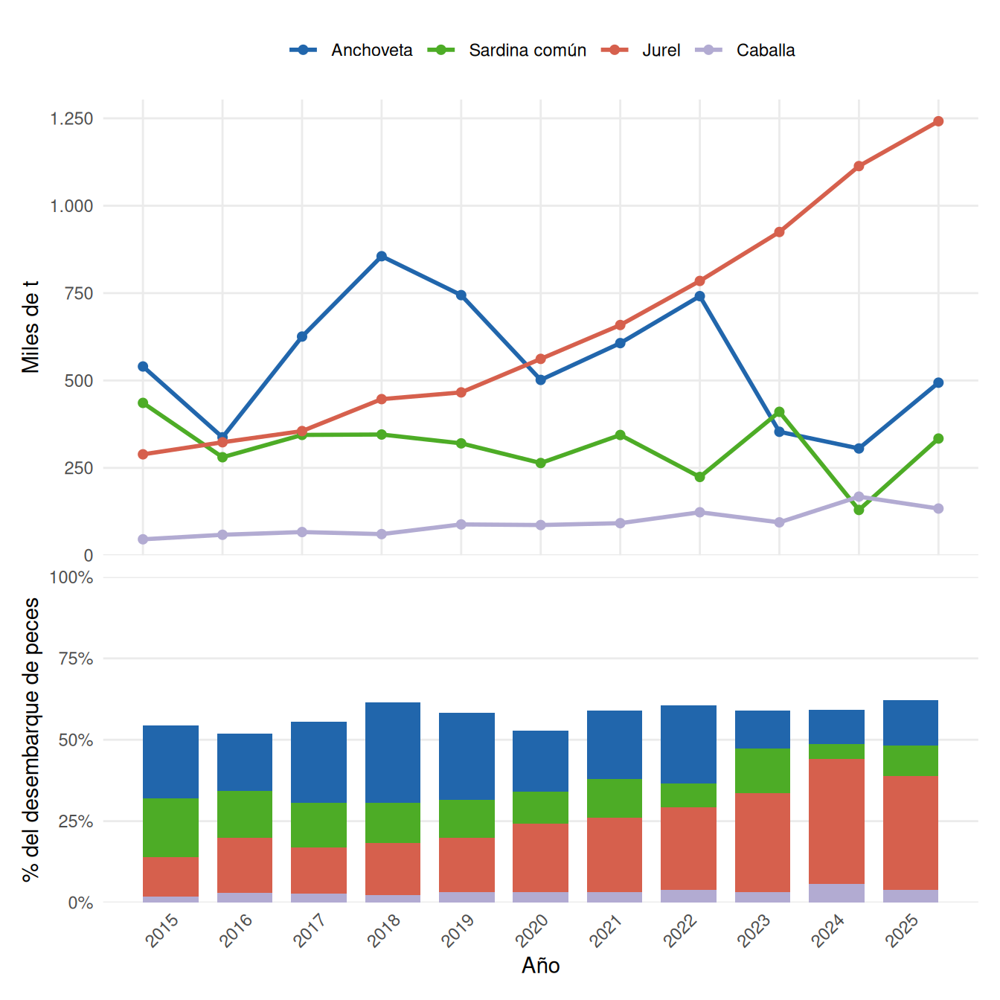
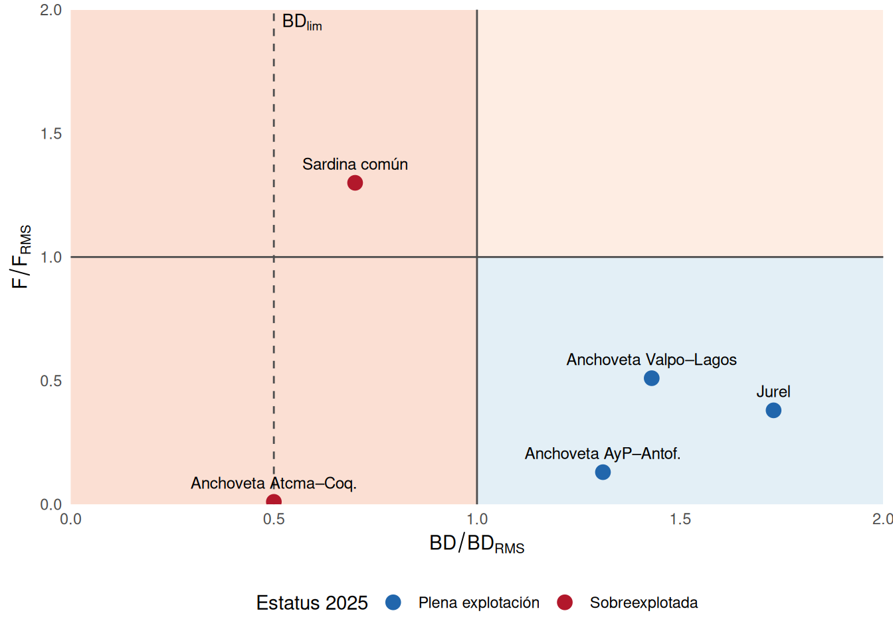

# Peces Pelágicos: Anchoveta, Sardina Común, Jurel y Caballa {#peces-pelagicos}

Los peces pelágicos sostienen las mayores pesquerías de Chile. En 2025, la anchoveta (*Engraulis ringens*), la sardina común (*Strangomera bentincki*), el jurel (*Trachurus murphyi*) y la caballa (*Scomber japonicus*) sumaron cerca de 2,2 millones de toneladas desembarcadas, alrededor del 62 % del desembarque de peces del país (SERNAPESCA, 2025). Estas especies habitan el **Sistema de la Corriente de Humboldt** (4°S–42°S), uno de los Sistemas de Surgencia de Borde Oriental (EBUS, por sus siglas en inglés), donde la surgencia costera aporta nutrientes que sostienen una alta producción primaria.

En este capítulo se revisan cuatro aspectos de su biología y manejo: (1) las características biológicas que comparten los peces pelágicos pequeños, (2) su rol en la trama trófica y su relación con la mortalidad natural, (3) las fluctuaciones interanuales y de largo plazo, junto con los cambios de productividad, y (4) el estado de situación y las medidas de manejo vigentes según el informe de SUBPESCA (2026).

## El escenario: el Sistema de la Corriente de Humboldt {#humboldt}

La costa de Perú y Chile no es un ambiente homogéneo. Montecino et al. (2006) distinguen tres subsistemas según el régimen de surgencia y el tipo de variabilidad dominante:

1. **4°–18°S (Perú)**: surgencia intensa y permanente; la variabilidad interanual está dominada por El Niño–Oscilación del Sur (ENOS).
2. **18°–30°S (norte de Chile)**: surgencia moderada; la temperatura superficial del mar (TSM) presenta oscilaciones casi periódicas en escalas interanual y decadal.
3. **30°–42°S (centro-sur de Chile)**: surgencia estacional, intensa en primavera-verano y reemplazada por convergencia en invierno, con fuerte mezcla turbulenta; la TSM oscila en escala decadal.

Esta zonación se refleja en la estructura de los stocks. La anchoveta presenta al menos cuatro unidades: el stock norte-centro de Perú, el stock del **sur de Perú–norte de Chile** (compartido entre ambos países), el stock de Atacama-Coquimbo del **centro-norte de Chile**, y el stock **centro-sur de Chile**. La sardina común se distribuye en el subsistema centro-sur, donde coexiste con la anchoveta (Cubillos et al., 2007). El jurel, en cambio, es un recurso transzonal y transfronterizo, que se distribuye desde Ecuador hasta el sur de Chile y, hacia el oeste, en aguas internacionales del Pacífico Suroriental.

## Características biológicas de los peces pelágicos pequeños {#biologia-ppp}

Los peces pelágicos pequeños (PPP) comparten un conjunto de rasgos de historia de vida:

- **Ciclo de vida corto** y **crecimiento rápido**, con fluctuaciones estacionales de la tasa de crecimiento.
- **Madurez temprana**: la mayoría madura al finalizar el primer año de vida.
- **Mortalidad natural alta**.
- **Reclutamiento muy variable** entre años; la pesquería depende de los pulsos anuales de reclutamiento.
- **Alta abundancia** en los sistemas de surgencia.
- **Sensibilidad al ambiente** en escalas estacional, interanual, decadal y de más largo plazo.
- Son **especies forraje** de nivel trófico bajo a intermedio y sirven de alimento a depredadores dependientes (aves, mamíferos marinos y otros peces).

Estos rasgos explican por qué la abundancia de los PPP puede cambiar en un orden de magnitud en pocos años, y por qué su manejo debe responder con rapidez a la información más reciente.

### Anchoveta — *Engraulis ringens* {#anchoveta}

La anchoveta (familia Engraulidae) es un pez filtrador de cuerpo alargado y boca grande que forma cardúmenes densos en la franja costera. Su talla rara vez supera los 20 cm.

**Ciclo de vida en la zona norte.** En la zona norte de Chile (Regiones de Arica y Parinacota a Antofagasta), el ciclo descrito por IFOP (Espíndola, 2021) es el siguiente: los huevos eclosionan en 1–3 días; la larva I dura unos 7 días y la larva II unos 60 días; la fase juvenil (~9,8 cm) dura unos 92 días y la fase pre-recluta otros 92 días. Los reclutas ingresan a la pesquería con ~12,5 cm, a unos 185 días de edad, y al año los ejemplares alcanzan ~16 cm. La talla media de madurez (TMM) es de ~11,5 cm. La actividad pesquera se organiza en dos fases explotables por año, separadas por una **veda de reclutamiento** (enero) y una **veda reproductiva** de 45 días (agosto–septiembre).

**Parámetros poblacionales.** La evaluación de stock de la anchoveta del sur de Perú–norte de Chile es semestral y estructurada por edad; utiliza un coeficiente de crecimiento K = 2,12 año⁻¹ y una mortalidad natural **M = 2,2 año⁻¹** (IFOP). Con un valor de M de esa magnitud, en ausencia de pesca solo sobrevive cerca del 11 % de una cohorte después de un año ($e^{-2,2} \approx 0,11$).

**Reproducción en la zona centro-sur.** La anchoveta desova en invierno y primavera; en el período 1993–1999 la estación reproductiva se extendió entre julio y diciembre, con un máximo del índice gonadosomático (IGS) hacia septiembre–octubre, y las hembras más grandes (≥16 cm) mantuvieron actividad gonadal casi todo el año (Cubillos & Claramunt, 2009). La talla media de madurez es de 12–12,5 cm, algo mayor que en la sardina común.

### Sardina común — *Strangomera bentincki* {#sardina-comun}

La sardina común (familia Clupeidae) es endémica de Chile y se distribuye en el subsistema centro-sur, con las mayores concentraciones entre Valparaíso y Los Lagos. Es planctófaga y forma cardúmenes mixtos con la anchoveta, con la que comparte áreas de desove y de alimentación (Cubillos et al., 2007).

**Ciclo biológico**

- **Desove**: invierno (julio–agosto), concentrado en la plataforma costera entre Constitución y Corral, con focos en el Golfo de Arauco y frente a Talcahuano (Cubillos et al., 1999). La primera madurez ocurre a 10–11 cm de longitud total (LT).
- **Huevos y larvas**: septiembre–octubre.
- **Reclutamiento**: noviembre–diciembre, con ejemplares de 4–6 cm LT, unos 3–4 meses después del desove.
- **Juveniles de 8–9 cm**: marzo–abril, cuando sostienen las mayores capturas del año (febrero–abril).

**Crecimiento.** El crecimiento de la sardina común es estacional: rápido en primavera-verano y casi nulo en otoño-invierno. Por ello se describe con la versión estacionalizada del modelo de von Bertalanffy (Cubillos et al., 2001):

$$L_t = L_\infty \left[1 - \exp\left\{-K(t-t_0) - \frac{CK}{2\pi}\left[\sin(2\pi(t-t_s)) - \sin(2\pi(t_0-t_s))\right]\right\}\right]$$

donde $C$ es la amplitud de la oscilación estacional y $t_s$ el momento del año en que el crecimiento es máximo. Al ajustar este modelo a cohortes sucesivas, Castillo-Jordán et al. (2010) estimaron $L_\infty$ entre ~15 y ~18,7 cm y $K$ entre ~0,6 y ~1,1 año⁻¹, con una **menor tasa de crecimiento en las cohortes nacidas a partir de 2000**.

**Fecundidad.** La fecundidad parcial (número de ovocitos por tanda de desove) aumenta en forma aproximadamente lineal con el peso corporal: hembras de 10 a 40 g liberan entre ~2.000 y ~20.000 ovocitos por tanda (Cubillos et al., 2011).

### Jurel — *Trachurus murphyi* {#jurel}

El jurel (familia Carangidae) es un pez pelágico de mayor tamaño y longevidad que la anchoveta y la sardina. Aunque a menudo se agrupa con los "pelágicos medianos", su historia de vida es la de un recurso **transzonal y migratorio** de amplia distribución en el Pacífico Sur.

**Ciclo de vida y estructura espacial.** Según el modelo conceptual usado en Chile:

- El **desove** ocurre en primavera (octubre–diciembre) en aguas oceánicas frente a Chile central.
- Los **juveniles** (< 25 cm) se concentran en el **área de crianza** de la zona norte, entre Arica y Antofagasta.
- Los **adultos** (> 25 cm) ocupan el **área de alimentación** de la zona centro-sur y migran hacia el área de desove.

La zona norte cumple, por tanto, un rol fundamental como área de crianza y reclutamiento para el stock. En el sector Arica–Antofagasta, el 77 % de los ejemplares capturados en 2017 midió menos de 26 cm (moda 24 cm); en 2018 la fracción subió a 99,9 % (moda 13 cm), y en 2025 el 62 % de la abundancia en la región oceánica de la zona norte correspondió a juveniles.

**Talla mínima legal.** Rige una talla mínima de 26 cm de longitud de horquilla, con una tolerancia máxima mensual de 25 % en número (SUBPESCA, 2026).

**Mortalidad natural.** A diferencia de los PPP, el jurel tiene una mortalidad natural moderada; la evaluación del stock en la SPRFMO utiliza un valor del orden de M ≈ 0,23 año⁻¹.

**Unidad de stock.** El manejo regional se basa en la hipótesis de **un solo stock** en el Pacífico Sur, evaluado por el Comité Científico de la Organización Regional de Ordenación Pesquera del Pacífico Sur (SPRFMO). El proyecto FIPA 2023-18 investiga la genómica poblacional del jurel para precisar esta hipótesis (SUBPESCA, 2026).

### Caballa — *Scomber japonicus* {#caballa}

La caballa (familia Scombridae) es, al igual que el jurel, un recurso pelágico **transzonal**. Su distribución se asocia a la interacción entre las Aguas Subtropicales Superficiales (ASS) y las Aguas Costeras Frías (ACF), por lo que su disponibilidad para la flota cambia con la temperatura y la estructura del hábitat. En el ecosistema cumple un doble papel: se alimenta de plancton y de peces pequeños (es depredador de anchoveta) y es a su vez presa de grandes pelágicos.

En Chile la caballa se captura principalmente con la flota de cerco que opera sobre anchoveta y jurel. Los desembarques de caballa aumentaron de ~46 mil t en 2015 a ~168 mil t en 2024 (Tabla \@ref(tab:tab-desem-pel)).

### Síntesis de rasgos biológicos

<table class="table table-striped table-hover" style="margin-left: auto; margin-right: auto;">
<caption>(\#tab:tab-rasgos-pel)Comparación de rasgos biológicos de los cuatro recursos pelágicos (fuentes en el texto). Un guion indica que el dato no se presenta en este capítulo.</caption>
 <thead>
  <tr>
   <th style="text-align:left;"> Rasgo </th>
   <th style="text-align:left;"> Anchoveta </th>
   <th style="text-align:left;"> Sardina común </th>
   <th style="text-align:left;"> Jurel </th>
   <th style="text-align:left;"> Caballa </th>
  </tr>
 </thead>
<tbody>
  <tr>
   <td style="text-align:left;font-weight: bold;"> Familia </td>
   <td style="text-align:left;"> Engraulidae </td>
   <td style="text-align:left;"> Clupeidae </td>
   <td style="text-align:left;"> Carangidae </td>
   <td style="text-align:left;"> Scombridae </td>
  </tr>
  <tr>
   <td style="text-align:left;font-weight: bold;"> Zona principal en Chile </td>
   <td style="text-align:left;"> Norte y centro-sur </td>
   <td style="text-align:left;"> Centro-sur </td>
   <td style="text-align:left;"> Norte (juveniles) y centro-sur (adultos) </td>
   <td style="text-align:left;"> Norte y centro </td>
  </tr>
  <tr>
   <td style="text-align:left;font-weight: bold;"> Talla de madurez </td>
   <td style="text-align:left;"> 11,5 cm (norte); 12–12,5 cm (centro-sur) </td>
   <td style="text-align:left;"> 10–11 cm LT </td>
   <td style="text-align:left;"> — </td>
   <td style="text-align:left;"> — </td>
  </tr>
  <tr>
   <td style="text-align:left;font-weight: bold;"> Época de desove </td>
   <td style="text-align:left;"> Invierno–primavera </td>
   <td style="text-align:left;"> Invierno (jul–ago) </td>
   <td style="text-align:left;"> Primavera (oct–dic), oceánico </td>
   <td style="text-align:left;"> — </td>
  </tr>
  <tr>
   <td style="text-align:left;font-weight: bold;"> Mortalidad natural (M) </td>
   <td style="text-align:left;"> Alta (2,2 año⁻¹, norte) </td>
   <td style="text-align:left;"> Alta </td>
   <td style="text-align:left;"> Moderada </td>
   <td style="text-align:left;"> — </td>
  </tr>
  <tr>
   <td style="text-align:left;font-weight: bold;"> Hábito alimentario </td>
   <td style="text-align:left;"> Planctófaga </td>
   <td style="text-align:left;"> Planctófaga </td>
   <td style="text-align:left;"> Zooplancton (eufausidos) y peces </td>
   <td style="text-align:left;"> Zooplancton y peces </td>
  </tr>
</tbody>
</table>

## Rol trófico y mortalidad natural {#rol-trofico}

### Especies forraje en una trama "de cintura de avispa"

Los PPP ocupan un nivel trófico cercano a 3: se alimentan de fitoplancton y zooplancton y son consumidos por grandes peces pelágicos, aves y mamíferos marinos (Puccinelli et al., 2021). En los sistemas de surgencia, unas pocas especies de PPP concentran gran parte de la biomasa en ese nivel intermedio, mientras que los niveles inferiores y superiores son más diversos. Esta estructura se denomina **"cintura de avispa"** (*wasp-waist*).

En una trama de cintura de avispa coexisten tres formas de control:

- **Control de abajo hacia arriba** (*bottom-up*): el ambiente regula el plancton, y este a los PPP y sus depredadores.
- **Control de arriba hacia abajo** (*top-down*): los depredadores regulan a los PPP, con efectos en cascada sobre el plancton.
- **Control de cintura de avispa**: el ambiente actúa directamente sobre los PPP, que a su vez controlan hacia arriba a sus depredadores y hacia abajo al zooplancton (Cury et al., 2000).

La consecuencia práctica es que la pesca de PPP no afecta solo a la especie objetivo. Al reducir la biomasa del nivel intermedio, la pesca puede propagarse a los depredadores que dependen de ella. En el Mar del Norte, por ejemplo, el análisis estadístico de la trama trófica mostró interacciones significativas entre la pesca, la temperatura, el plancton, los peces forraje y las aves marinas (Lynam et al., 2017).

### Un ejemplo chileno: la sardina austral

La pesquería de sardina austral (*Sprattus fuegensis*) en el mar interior de la Región de Los Lagos comenzó en 2006. Neira et al. (2015) construyeron un modelo trófico de ese ecosistema y simularon el efecto de aumentar la mortalidad por pesca (F) de la sardina austral respecto del nivel de 2006 (F~2006~ = 0,28). Al duplicar la mortalidad por pesca, la biomasa de los depredadores que dependen de ella (merluza austral y congrio) colapsaba, mientras que otros peces pelágicos competidores aumentaban. El resultado muestra que un nivel de pesca sostenible para la especie forraje puede no serlo para sus depredadores.

### Mortalidad natural y depredación

En los PPP, la mortalidad natural (M) es alta y está dominada por la **depredación**. Por eso M no es una constante biológica fija: cambia con la abundancia y la distribución de los depredadores. Dos ejemplos del informe de SUBPESCA (2026) lo ilustran:

- En la anchoveta de las Regiones de Atacama y Coquimbo, la caída del stock desde el segundo semestre de 2023 se atribuye a forzantes ambientales asociados a El Niño 2023–2024 (aguas cálidas, baja clorofila y surgencia débil), que habrían comprimido el hábitat del stock en presencia de **una alta abundancia de depredadores (jurel, bonito y caballa)**. El informe menciona un posible **aumento de la mortalidad natural** como una de las causas de la baja disponibilidad.
- En el mismo período, la flota artesanal cambió su táctica de pesca hacia jurel y caballa, cuya abundancia en la costa aumentó.

Para el manejo, esto implica que los puntos biológicos de referencia calculados con un valor de M constante pueden ser optimistas cuando aumenta la depredación.

## Fluctuaciones interanuales y de largo plazo {#fluctuaciones}

### Desembarques recientes (2015–2025)

(\#fig:fig-desem-pel)Desembarques (miles de t) de anchoveta, sardina común, jurel y caballa en Chile, 2015–2025. Arriba: series por especie. Abajo: participación de los cuatro recursos en el desembarque total de peces. Fuente: SERNAPESCA (2025).

<table class="table table-striped table-hover" style="width: auto !important; margin-left: auto; margin-right: auto;">
<caption>(\#tab:tab-desem-pel)Estadística descriptiva de los desembarques 2015–2025. CV: coeficiente de variación interanual. Fuente: SERNAPESCA (2025).</caption>
 <thead>
  <tr>
   <th style="text-align:left;"> Especie </th>
   <th style="text-align:right;"> Media (t) </th>
   <th style="text-align:right;"> Mínimo (t, año) </th>
   <th style="text-align:right;"> Máximo (t, año) </th>
   <th style="text-align:right;"> CV (%) </th>
  </tr>
 </thead>
<tbody>
  <tr>
   <td style="text-align:left;"> Anchoveta </td>
   <td style="text-align:right;"> 555.041 </td>
   <td style="text-align:right;"> 305.498 (2024) </td>
   <td style="text-align:right;"> 855.528 (2018) </td>
   <td style="text-align:right;"> 33 </td>
  </tr>
  <tr>
   <td style="text-align:left;"> Sardina común </td>
   <td style="text-align:right;"> 311.995 </td>
   <td style="text-align:right;"> 129.619 (2024) </td>
   <td style="text-align:right;"> 435.863 (2015) </td>
   <td style="text-align:right;"> 27 </td>
  </tr>
  <tr>
   <td style="text-align:left;"> Jurel </td>
   <td style="text-align:right;"> 651.403 </td>
   <td style="text-align:right;"> 288.772 (2015) </td>
   <td style="text-align:right;"> 1.241.775 (2025) </td>
   <td style="text-align:right;"> 50 </td>
  </tr>
  <tr>
   <td style="text-align:left;"> Caballa </td>
   <td style="text-align:right;"> 92.373 </td>
   <td style="text-align:right;"> 45.687 (2015) </td>
   <td style="text-align:right;"> 167.677 (2024) </td>
   <td style="text-align:right;"> 40 </td>
  </tr>
</tbody>
</table>

Las series muestran dos patrones distintos:

- **Anchoveta y sardina común** fluctúan sin tendencia clara y con alta variabilidad interanual. La sardina común cayó de 410 mil t en 2023 a 130 mil t en 2024 y volvió a 334 mil t en 2025. Estas oscilaciones reflejan los pulsos de reclutamiento: como la pesquería depende de una o dos clases anuales, un reclutamiento débil se traduce en una caída inmediata de las capturas.
- **Jurel y caballa** muestran una tendencia creciente y sostenida. El desembarque de jurel se multiplicó por más de cuatro (de 289 mil t en 2015 a 1,24 millones de t en 2025), en coherencia con la recuperación del stock y el aumento de la cuota (sección \@ref(manejo-pel)).

### Destino de los desembarques

<table class="table table-striped table-hover" style="width: auto !important; margin-left: auto; margin-right: auto;">
<caption>(\#tab:tab-productos-pel)Producción (t de producto final) de harina, congelado y conservas por especie, 2015 y 2025. Las cifras corresponden a peso de producto, no a materia prima. Fuente: SERNAPESCA (2025).</caption>
 <thead>
<tr>
<th style="empty-cells: hide;border-bottom:hidden;" colspan="1"></th>
<th style="border-bottom:hidden;padding-bottom:0; padding-left:3px;padding-right:3px;text-align: center; " colspan="2">
Harina
</th>
<th style="border-bottom:hidden;padding-bottom:0; padding-left:3px;padding-right:3px;text-align: center; " colspan="2">
Congelado
</th>
<th style="border-bottom:hidden;padding-bottom:0; padding-left:3px;padding-right:3px;text-align: center; " colspan="2">
Conservas
</th>
</tr>
  <tr>
   <th style="text-align:left;"> Especie </th>
   <th style="text-align:right;"> 2015 </th>
   <th style="text-align:right;"> 2025 </th>
   <th style="text-align:right;"> 2015 </th>
   <th style="text-align:right;"> 2025 </th>
   <th style="text-align:right;"> 2015 </th>
   <th style="text-align:right;"> 2025 </th>
  </tr>
 </thead>
<tbody>
  <tr>
   <td style="text-align:left;"> Anchoveta </td>
   <td style="text-align:right;"> 117.887 </td>
   <td style="text-align:right;"> 103.324 </td>
   <td style="text-align:right;"> 2 </td>
   <td style="text-align:right;"> 3 </td>
   <td style="text-align:right;"> 14 </td>
   <td style="text-align:right;"> 0 </td>
  </tr>
  <tr>
   <td style="text-align:left;"> Sardina común </td>
   <td style="text-align:right;"> 84.897 </td>
   <td style="text-align:right;"> 60.362 </td>
   <td style="text-align:right;"> 138 </td>
   <td style="text-align:right;"> 4 </td>
   <td style="text-align:right;"> 0 </td>
   <td style="text-align:right;"> 0 </td>
  </tr>
  <tr>
   <td style="text-align:left;"> Jurel </td>
   <td style="text-align:right;"> 33.219 </td>
   <td style="text-align:right;"> 147.735 </td>
   <td style="text-align:right;"> 70.205 </td>
   <td style="text-align:right;"> 519.514 </td>
   <td style="text-align:right;"> 27.444 </td>
   <td style="text-align:right;"> 30.506 </td>
  </tr>
  <tr>
   <td style="text-align:left;"> Caballa </td>
   <td style="text-align:right;"> 10.151 </td>
   <td style="text-align:right;"> 28.733 </td>
   <td style="text-align:right;"> 379 </td>
   <td style="text-align:right;"> 9.485 </td>
   <td style="text-align:right;"> 218 </td>
   <td style="text-align:right;"> 142 </td>
  </tr>
</tbody>
</table>

La anchoveta y la sardina común se destinan casi por completo a **harina y aceite de pescado** (reducción). El jurel, en cambio, se destina principalmente al **congelado para consumo humano**, cuya producción pasó de 70 mil t en 2015 a 520 mil t en 2025.

### Variabilidad climática y El Niño

En la zona norte, los desembarques de las principales especies pelágicas en Arica, Iquique y Mejillones superaron los 3 millones de t a mediados de la década de 1980 y han disminuido desde entonces a niveles de ~0,5 millones de t. Cada evento El Niño intenso (1982–83, 1987, 1991–92, 1997–98, 2009–10 y 2015–16) coincidió con una caída de las capturas (IFOP, en Cubillos, 2025). El caso extremo fue 1998, cuando los desembarques de la zona norte casi desaparecieron.

Los eventos cálidos actúan por varias vías:

- **Redistribución**: la anchoveta se repliega hacia la costa y hacia el sur, o se profundiza, y cambia su disponibilidad para la flota.
- **Reducción de la productividad**: la surgencia se debilita y disminuye el alimento.
- **Cambios demográficos**: la anchoveta del norte presenta cambios en el IGS, en la condición somática y en la extensión de la época reproductiva (Hernández-Santoro et al., 2018).

### Disminución de la talla media de la anchoveta del norte

La talla media de la anchoveta del sur de Perú–norte de Chile ha disminuido en forma significativa: −0,05 cm/año en las capturas chilenas y −0,08 cm/año en las peruanas (P < 0,05). Canales et al. (2018) concluyeron que los períodos cálidos tipo El Niño afectaron los rasgos demográficos de la anchoveta y que estos cambios **no parecen ser consecuencia de la intensidad de pesca**. No encontraron un efecto directo de la TSM, sino un efecto indirecto a través del nivel medio del mar.

Un análisis complementario con modelos lineales (Cubillos, no publicado) indica que la talla media disminuye ~0,49 cm por cada 1 °C de aumento de la TSM, y que la talla media del segundo semestre es ~1,3 cm menor que la del primero.

### Reclutamiento y ambiente

En la zona centro-sur, el reclutamiento de la sardina común se relaciona **negativamente** con las anomalías de TSM y con el índice de surgencia durante el desove (julio–agosto), y negativamente con las anomalías de TSM durante la fase pre-recluta (agosto–diciembre) (Arteaga et al., 2014). En la anchoveta, la variabilidad del viento modula el reclutamiento en el sur del Sistema de Humboldt (Arteaga et al., 2024). En ambos casos, otras variables ambientales durante el desove o la fase pre-recluta podrían modular las fluctuaciones interanuales.

### Escala de largo plazo: alternancia sardina–anchoveta

A escala decadal, los sistemas de surgencia del Pacífico muestran una alternancia entre períodos dominados por sardinas y períodos dominados por anchovetas, asociados a cambios de régimen de la temperatura del océano: los períodos cálidos favorecen a la sardina española (*Sardinops sagax*) y los fríos a la anchoveta (Chávez et al., 2003). En el norte de Chile, la sardina española sostuvo grandes capturas durante las décadas de 1970 y 1980 y luego prácticamente desapareció de los desembarques; entre 2015 y 2025 registró menos de 10 mil t anuales (SERNAPESCA, 2025).

### Jurel: colapso, recuperación y cambio de distribución

La historia del jurel ilustra la combinación de sobrepesca y variabilidad ambiental. Las capturas en el Pacífico Sur, dominadas por la flota del centro-sur de Chile, alcanzaron un máximo cercano a 5 millones de t a mediados de la década de 1990. Luego vino un período de sobreexplotación que redujo la biomasa desovante a ~13 % de su nivel no explotado hacia 2013, y la pesquería pasó a ser administrada por la SPRFMO.

Entre 2008 y 2011, las zonas de pesca se extendieron hacia aguas internacionales, hasta cerca de los 100°W, mientras las capturas caían de ~729 mil t (2008) a ~216 mil t (2011) (Cubillos, 2025). Desde 2012 las capturas se concentran nuevamente en la franja costera del centro-sur. Hoy el stock se ha recuperado: la biomasa desovante de 2025 se estimó en 17,9 millones de t (sección \@ref(manejo-pel)). Aun así, el jurel no se encuentra donde estaba: la hipótesis actual es una **redistribución del recurso inducida por el clima**.

Plaza-Vega et al. (2026) mostraron con un modelo del jurel del centro-sur que el rendimiento simulado cambia con la temperatura y con el esfuerzo de pesca: **una misma intensidad de pesca puede producir resultados distintos según el ambiente**.

### Caballa: distribución y ambiente en Perú (2023–2025)

La caballa ofrece un ejemplo reciente de cómo el ambiente modifica la disponibilidad de un recurso. Cuevas y Cubillos (2026) sintetizaron los informes de IMARPE para 2023–2025 (Tabla \@ref(tab:tab-caballa-peru)).

<table class="table table-striped table-hover" style="margin-left: auto; margin-right: auto;">
<caption>(\#tab:tab-caballa-peru)Caballa en Perú, 2023–2025: ambiente, distribución, biomasa acústica y desembarques. Fuente: IMARPE (2023, 2024, 2025), sintetizado por Cuevas y Cubillos (2026).</caption>
 <thead>
  <tr>
   <th style="text-align:left;"> Variable </th>
   <th style="text-align:left;"> 2023 </th>
   <th style="text-align:left;"> 2024 </th>
   <th style="text-align:left;"> 2025 </th>
  </tr>
 </thead>
<tbody>
  <tr>
   <td style="text-align:left;font-weight: bold;"> Ambiente </td>
   <td style="text-align:left;"> El Niño costero, anomalías cálidas </td>
   <td style="text-align:left;"> Transición a neutralidad </td>
   <td style="text-align:left;"> Enfriamiento relativo </td>
  </tr>
  <tr>
   <td style="text-align:left;font-weight: bold;"> Distribución </td>
   <td style="text-align:left;"> Amplia y dispersa </td>
   <td style="text-align:left;"> Núcleos fragmentados; 99 % juveniles en el crucero de verano </td>
   <td style="text-align:left;"> Restringida al norte en primavera </td>
  </tr>
  <tr>
   <td style="text-align:left;font-weight: bold;"> Biomasa acústica de verano </td>
   <td style="text-align:left;"> ~236.000 t </td>
   <td style="text-align:left;"> 131.746 t </td>
   <td style="text-align:left;"> 27.458 t </td>
  </tr>
  <tr>
   <td style="text-align:left;font-weight: bold;"> Desembarque </td>
   <td style="text-align:left;"> 58.654 t (ene–nov) </td>
   <td style="text-align:left;"> ~42.000 t </td>
   <td style="text-align:left;"> ~33.000 t (esperado) </td>
  </tr>
</tbody>
</table>

Bajo las condiciones cálidas de 2023, la caballa se distribuyó en forma amplia y su biomasa acústica fue alta. Hacia 2025 la biomasa observada, el área ocupada y los desembarques disminuyeron en conjunto.

> **Tres señales que no deben confundirse**
>
> - **Desembarque**: cuánto llegó a puerto bajo un determinado esfuerzo y regulación. Refleja la operación y el mercado, no solo la abundancia.
> - **CPUE**: captura por unidad de esfuerzo; aproxima la abundancia relativa, pero responde también a la distribución del recurso, a la tecnología y a la conducta de la flota.
> - **Biomasa**: estimación del recurso según un método, un área y un período. La biomasa acústica de un crucero y la de un modelo poblacional no son magnitudes intercambiables, sino piezas complementarias.

## Cambios en la productividad {#productividad}

La productividad de un stock depende del crecimiento, la madurez y el reclutamiento. En los peces pelágicos chilenos hay evidencia de cambios en los tres.

### Crecimiento más lento en la sardina común

Las cohortes de sardina común nacidas desde 2000 muestran una menor tasa de crecimiento. El índice de crecimiento $\phi' = \log_{10} K + 2\log_{10} L_\infty$ fue mayor en 1990–1999 que en 2000–2006 (Castillo-Jordán et al., 2010). Un crecimiento más lento implica que los peces tardan más en alcanzar la talla de madurez y la talla comercial.

### Efectos demográficos de la pesca: desove retrasado

Cubillos et al. (2014) analizaron cómo la pesca intensa sobre juveniles afecta el ciclo de desove de la sardina común. El razonamiento es el siguiente:

- **Sin pesca**, la población incluye peces de varias tallas. Los peces grandes (~15 cm) desovan temprano (mayo–agosto) y los primerizos (~11 cm) más tarde (agosto–noviembre), de modo que la estación reproductiva es larga.
- **Con pesca muy intensa**, los juveniles se capturan antes de crecer y el stock se sustenta en peces de primera reproducción. La estación de desove se **retrasa**, se **acorta** y depende de reproductores primerizos.

Los datos respaldan esta hipótesis. El máximo del IGS se desplazó de julio–agosto en 1993–1999 a septiembre en 2000–2010, y la distribución de tallas de agosto se volvió más estrecha, con menos peces grandes. Como la calidad y el tamaño de los huevos dependen del tamaño y la edad de la madre, un desove sustentado en reproductores primerizos podría ser una desventaja para la progenie. Además, si la pesca selecciona en forma persistente a los peces de crecimiento rápido, puede inducir cambios evolutivos en la población (Conover & Munch, 2002).

### Productividad y puntos de referencia

Los cambios de productividad se incorporan al manejo de distintas formas:

- Para el **jurel**, los puntos biológicos de referencia se calculan bajo un **escenario de baja productividad** en la relación stock-recluta, asociado al período 2001–2015 (SUBPESCA, 2026).
- Para la **sardina común**, la captura biológicamente aceptable (CBA) de 2026 se calculó con un **escenario de reclutamientos bajos** (1992–2007), porque el estado actual se atribuye a la tendencia decreciente de los reclutamientos (SUBPESCA, 2026).
- Para la **anchoveta de Atacama–Coquimbo**, el modelo de evaluación sugiere un **cambio en la escala poblacional** del stock asociado a El Niño 2023–2024 (SUBPESCA, 2026).

## Manejo y estado de situación {#manejo-pel}

### Marco biológico de referencia

La Ley General de Pesca y Acuicultura (LGPA) establece que las pesquerías deben alcanzar o mantenerse en torno al **Rendimiento Máximo Sostenible (RMS)**: la mayor captura promedio que puede extraerse de un stock en forma sostenible bajo las condiciones ecológicas y ambientales predominantes.

Para los pequeños pelágicos, el Comité Científico Técnico de Pequeños Pelágicos (CCT-PP) usa como aproximación (*proxy*) del RMS reducir la biomasa desovante por recluta (BDPR) al 60 % de su valor sin pesca:

- Mortalidad por pesca objetivo: $F_{RMS} \approx F_{60\%BDPR}$.
- Biomasa desovante objetivo: $BD_{RMS} = 55\%\,BD_0$ (equivalente a 60 % de la BDPR).
- Biomasa límite: $BD_{lim} = 27{,}5\%\,BD_0$, es decir, la mitad de la biomasa objetivo.

La anchoveta del norte usa valores algo distintos ($F_{55\%BDPR}$, $BD_{RMS} = 50\%\,BD_0$, $BD_{lim} = 25\%\,BD_0$). Para el jurel, el Comité Científico Técnico del Jurel (CCT-J) adopta los puntos de referencia **dinámicos** de la SPRFMO.

<table class="table table-striped table-hover" style="margin-left: auto; margin-right: auto;">
<caption>(\#tab:tab-pbr-pel)Puntos biológicos de referencia de las pesquerías pelágicas. Fuente: SUBPESCA (2026).</caption>
 <thead>
  <tr>
   <th style="text-align:left;"> Pesquería </th>
   <th style="text-align:left;"> Modelo de evaluación </th>
   <th style="text-align:left;"> F objetivo </th>
   <th style="text-align:left;"> BD objetivo </th>
   <th style="text-align:left;"> BD límite </th>
  </tr>
 </thead>
<tbody>
  <tr>
   <td style="text-align:left;"> Anchoveta (Arica y Parinacota – Antofagasta) </td>
   <td style="text-align:left;"> Edad, semestral, dos flotas </td>
   <td style="text-align:left;"> F55% BDPR = 0,13 sem⁻¹ </td>
   <td style="text-align:left;"> 50% BD0 = 624.000 t </td>
   <td style="text-align:left;"> 25% BD0 = 312.000 t </td>
  </tr>
  <tr>
   <td style="text-align:left;"> Anchoveta (Atacama – Coquimbo) </td>
   <td style="text-align:left;"> Edad, anual </td>
   <td style="text-align:left;"> F60% BDPR = 0,65 </td>
   <td style="text-align:left;"> 55% BD0 = 57.900 t </td>
   <td style="text-align:left;"> 27,5% BD0 = 29.000 t </td>
  </tr>
  <tr>
   <td style="text-align:left;"> Anchoveta (Valparaíso – Los Lagos) </td>
   <td style="text-align:left;"> Edad, año biológico </td>
   <td style="text-align:left;"> F60% BDPR = 0,62 </td>
   <td style="text-align:left;"> 55% BD0 = 465.000 t </td>
   <td style="text-align:left;"> 27,5% BD0 = 232.500 t </td>
  </tr>
  <tr>
   <td style="text-align:left;"> Sardina común (Valparaíso – Los Lagos) </td>
   <td style="text-align:left;"> Edad, año biológico </td>
   <td style="text-align:left;"> F60% BDPR = 0,31 </td>
   <td style="text-align:left;"> 55% BD0 = 859.000 t </td>
   <td style="text-align:left;"> 27,5% BD0 = 429.500 t </td>
  </tr>
  <tr>
   <td style="text-align:left;"> Jurel (Pacífico Sur, un stock) </td>
   <td style="text-align:left;"> Edad (SPRFMO) </td>
   <td style="text-align:left;"> 0,54 año⁻¹ </td>
   <td style="text-align:left;"> 35% BD0 = 9,1 millones t </td>
   <td style="text-align:left;"> 8% BD0 = 2,08 millones t </td>
  </tr>
</tbody>
</table>

### Estado de situación 2025

(\#fig:fig-kobe-pel)Diagrama de fase (Kobe) del estado de las pesquerías pelágicas según la evaluación más reciente: biomasa desovante relativa al objetivo (BD/BD~RMS~) y mortalidad por pesca relativa al objetivo (F/F~RMS~). La línea vertical punteada marca la biomasa límite de los pequeños pelágicos (BD~lim~ = 0,5 BD~RMS~). Anchoveta Arica y Parinacota–Antofagasta: segundo semestre de 2024; Atacama–Coquimbo: 2025 (preliminar). Fuente: SUBPESCA (2026).

**Anchoveta, Arica y Parinacota a Antofagasta — Plena explotación.** Al segundo semestre de 2024, la mortalidad por pesca estaba 87 % por debajo de F~RMS~ y la biomasa desovante 31 % sobre BD~RMS~. A escala anual, la biomasa desovante se ubica 1 % bajo BD~RMS~ (probabilidad de 0,26 de estar sobreexplotada). En 2025 esta pesquería pasó de *sobreexplotada* a *plena explotación* (SUBPESCA, 2026).

**Anchoveta, Atacama y Coquimbo — Sobreexplotada.** La biomasa desovante proyectada a 2025 equivale a la mitad de BD~RMS~ (BD/BD~RMS~ = 0,5), con una probabilidad de 0,53 de estar agotada o colapsada. La mortalidad por pesca se estima cercana a cero porque no hubo capturas desde el segundo semestre de 2023. La condición se explica por el debilitamiento de las clases anuales 2023 y 2025 y por los efectos de El Niño 2023–2024 descritos en la sección \@ref(rol-trofico), y **no** sería consecuencia de la actividad pesquera.

**Anchoveta, Valparaíso a Los Lagos — Plena explotación.** BD/BD~RMS~ = 1,43 y F/F~RMS~ = 0,51, con una probabilidad de sobreexplotación de 0,009. La condición favorable se debe al aumento de los reclutamientos desde 2018/2019, a la disminución de la mortalidad por pesca y al aumento sostenido de la biomasa en los últimos cuatro años.

**Sardina común, Valparaíso a Los Lagos — Sobreexplotada.** BD/BD~RMS~ = 0,70 y F/F~RMS~ = 1,3, con una probabilidad de sobrepesca de 0,74. La biomasa desovante está 30 % bajo el objetivo y la mortalidad por pesca 30 % sobre él. El informe atribuye esta condición a la **tendencia decreciente de los reclutamientos**.

**Jurel — Plena explotación.** Tras los mínimos de biomasa registrados hasta 2011, el stock se recuperó en forma sostenida. En 2025 la biomasa desovante se estimó en 17,9 millones de t (~70 % de BD~0~ y 1,73 veces BD~RMS~). La mortalidad por pesca ha sido baja desde 2013 y en 2025 fue de 0,20 año⁻¹ (38 % de F~RMS~). Los reclutamientos a la edad 1 repuntaron en 2024–2025 a ~17–18 mil millones de individuos, el promedio de la última década.

**Caballa.** La caballa no figura entre las pesquerías con puntos biológicos de referencia y estatus del informe de SUBPESCA (2026). En Perú, IMARPE estimó en 2025 una disminución de 22 % de la biomasa total y de 19 % de la biomasa desovante respecto de 2024, aunque esta última se mantiene sobre su referencia de RMS (Cubillos, 2026).

### Medidas de administración

<table class="table table-striped table-hover" style="margin-left: auto; margin-right: auto;">
<caption>(\#tab:tab-manejo-pel)Medidas de administración de las pesquerías pelágicas. Todas están declaradas en régimen de plena explotación, con acceso cerrado y arte de cerco. Fuente: SUBPESCA (2026).</caption>
 <thead>
  <tr>
   <th style="text-align:left;"> Pesquería </th>
   <th style="text-align:left;"> Estatus 2025 </th>
   <th style="text-align:right;"> Cuota global 2026 (t) </th>
   <th style="text-align:left;"> Vedas / tallas </th>
   <th style="text-align:left;"> Otras medidas </th>
  </tr>
 </thead>
<tbody>
  <tr>
   <td style="text-align:left;"> Anchoveta (AyP – Coquimbo) </td>
   <td style="text-align:left;"> Plena (AyP–Antof.) / Sobreexplotada (Atcma–Coq.) </td>
   <td style="text-align:right;"> 399.574 </td>
   <td style="text-align:left;"> Reproductiva y de reclutamiento (norte); reproductiva (Atcma–Coq.) </td>
   <td style="text-align:left;"> Plan de manejo; Ley de fraccionamiento (Ley N° 21.752/2025) </td>
  </tr>
  <tr>
   <td style="text-align:left;"> Anchoveta (Valparaíso – Los Lagos) </td>
   <td style="text-align:left;"> Plena explotación </td>
   <td style="text-align:right;"> 225.849 </td>
   <td style="text-align:left;"> Reproductiva y de reclutamiento </td>
   <td style="text-align:left;"> Imputación conjunta con sardina común; plan de manejo </td>
  </tr>
  <tr>
   <td style="text-align:left;"> Sardina común (Valparaíso – Los Lagos) </td>
   <td style="text-align:left;"> Sobreexplotada </td>
   <td style="text-align:right;"> 213.800 </td>
   <td style="text-align:left;"> Reproductiva y de reclutamiento </td>
   <td style="text-align:left;"> Imputación conjunta con anchoveta; plan de manejo </td>
  </tr>
  <tr>
   <td style="text-align:left;"> Jurel (AyP – Los Lagos) </td>
   <td style="text-align:left;"> Plena explotación </td>
   <td style="text-align:right;"> 1.178.348 </td>
   <td style="text-align:left;"> Talla mínima legal 26 cm LH </td>
   <td style="text-align:left;"> Cuota nacional = 66 % de la cuota SPRFMO; plan de manejo </td>
  </tr>
</tbody>
</table>

Algunos aspectos del manejo merecen destacarse:

- **Ciclo anual de manejo**: la CBA se fija con la evaluación de stock del año anterior y se **actualiza** durante el año con la información de los cruceros acústicos y del método de producción diaria de huevos (MPDH, o DEPM en inglés). Las vedas reproductiva y de reclutamiento se alinean con el ciclo de vida descrito en la sección \@ref(biologia-ppp).
- **Imputación conjunta**: en la zona centro-sur, las capturas de anchoveta y sardina común se imputan en conjunto porque ambas especies forman cardúmenes mixtos y la flota no puede separarlas.
- **Jurel y SPRFMO**: el CCT-J recomendó una CBA de 1.785.375 a 2.231.719 t para el Pacífico Sur. SUBPESCA adoptó el límite inferior; con la asignación de 66 % para Chile, la cuota nacional de 2026 es de 1.178.348 t.
- **Remanentes y fraccionamiento**: el CCT-PP calculó rangos de CBA con y sin "Ley de remanentes" (traspaso de cuota no capturada al año siguiente). La Ley N° 21.752/2025 integró la anchoveta de Arica y Parinacota a Coquimbo en una sola pesquería, aunque el CCT-PP no recomendó una CBA integrada por falta de una evaluación conjunta. El año 2026 se considera de transición.

### Hacia un manejo adaptativo

Los peces pelágicos responden con rapidez a la variabilidad climática, y la evidencia reciente indica que el clima está redistribuyendo estos recursos. El **manejo adaptativo** trata las estrategias de manejo como experimentos continuos: aprende de los cambios observados en indicadores poblacionales y operacionales y ajusta las medidas en forma iterativa (FAO, 2021). Para los PPP, esto implica integrar la distribución, la biomasa acústica, el reclutamiento y el desembarque en una lectura conjunta, en lugar de interpretar cada indicador por separado.

## Síntesis comparativa {#sintesis-pel}

<table class="table table-striped table-hover" style="margin-left: auto; margin-right: auto;">
<caption>(\#tab:tab-sintesis-pel)Síntesis de los recursos pelágicos analizados en este capítulo.</caption>
 <thead>
  <tr>
   <th style="text-align:left;"> Especie </th>
   <th style="text-align:left;"> Nombre común </th>
   <th style="text-align:left;"> Rol trófico </th>
   <th style="text-align:left;"> Variabilidad dominante </th>
   <th style="text-align:left;"> Estado 2025 </th>
  </tr>
 </thead>
<tbody>
  <tr>
   <td style="text-align:left;"> *Engraulis ringens* </td>
   <td style="text-align:left;"> Anchoveta </td>
   <td style="text-align:left;"> Forraje (planctófaga) </td>
   <td style="text-align:left;"> Interanual alta; El Niño </td>
   <td style="text-align:left;"> Plena (norte y centro-sur); sobreexplotada (Atcma–Coq.) </td>
  </tr>
  <tr>
   <td style="text-align:left;"> *Strangomera bentincki* </td>
   <td style="text-align:left;"> Sardina común </td>
   <td style="text-align:left;"> Forraje (planctófaga) </td>
   <td style="text-align:left;"> Interanual alta; reclutamiento </td>
   <td style="text-align:left;"> Sobreexplotada </td>
  </tr>
  <tr>
   <td style="text-align:left;"> *Trachurus murphyi* </td>
   <td style="text-align:left;"> Jurel </td>
   <td style="text-align:left;"> Depredador intermedio </td>
   <td style="text-align:left;"> Decadal; redistribución </td>
   <td style="text-align:left;"> Plena explotación </td>
  </tr>
  <tr>
   <td style="text-align:left;"> *Scomber japonicus* </td>
   <td style="text-align:left;"> Caballa </td>
   <td style="text-align:left;"> Depredador intermedio </td>
   <td style="text-align:left;"> Interanual; distribución </td>
   <td style="text-align:left;"> Sin estatus en Chile </td>
  </tr>
</tbody>
</table>

## Glosario {#glosario-pel}

**BD~RMS~**: biomasa desovante que, en equilibrio, produce el rendimiento máximo sostenible. Se usa como biomasa objetivo.

**BD~lim~**: biomasa desovante límite, bajo la cual la pesquería se considera agotada o colapsada y el reclutamiento puede verse comprometido.

**BDPR**: biomasa desovante por recluta; biomasa reproductora que aporta en promedio cada recluta a lo largo de su vida, para un nivel dado de mortalidad por pesca.

**CBA**: Captura Biológicamente Aceptable; captura máxima recomendada por el comité científico para un año.

**Cintura de avispa** (*wasp-waist*): estructura de una trama trófica en la que pocas especies dominan un nivel intermedio y controlan tanto a sus presas como a sus depredadores.

**Diagrama de Kobe**: gráfico que ubica el estado de un stock según su biomasa relativa al objetivo (eje x) y su mortalidad por pesca relativa al objetivo (eje y).

**EBUS**: Sistemas de Surgencia de Borde Oriental (Humboldt, California, Benguela y Canarias).

**ENOS**: El Niño–Oscilación del Sur; ciclo acoplado océano-atmósfera del Pacífico ecuatorial.

**Especie forraje**: especie de nivel trófico bajo a intermedio que transfiere energía del plancton a los depredadores superiores.

**IGS**: índice gonadosomático; peso de la gónada como porcentaje del peso corporal.

**MPDH (DEPM)**: método de producción diaria de huevos; estima la biomasa desovante a partir de la abundancia de huevos en el plancton.

**Mortalidad natural (M)**: tasa instantánea de muerte por causas distintas de la pesca (depredación, enfermedad, inanición).

**Recurso transzonal**: recurso que se distribuye tanto dentro de la zona económica exclusiva como en alta mar.

**SPRFMO**: Organización Regional de Ordenación Pesquera del Pacífico Sur.

## Preguntas de autoevaluación {#preguntas-pel}

### Nivel básico — comprensión

1. Enumere cinco rasgos de historia de vida que caracterizan a los peces pelágicos pequeños y explique por qué hacen que su abundancia sea muy variable.

2. Describa el ciclo biológico anual de la sardina común: ¿cuándo desova, cuándo recluta y a qué talla madura?

3. ¿Qué rol cumple la zona norte de Chile en el ciclo de vida del jurel? ¿Por qué es relevante para el manejo la talla mínima legal de 26 cm?

4. Explique la diferencia entre desembarque, CPUE y biomasa como indicadores del estado de un recurso.

### Nivel intermedio — análisis

5. Si la mortalidad natural de la anchoveta del norte es M = 2,2 año⁻¹, calcule la fracción de una cohorte que sobrevive al cabo de 6 meses y de 1 año en ausencia de pesca. ¿Qué implica este resultado para la duración de la fase explotable?

6. Explique el concepto de control "de cintura de avispa" y aplíquelo al caso de la sardina austral analizado por Neira et al. (2015).

7. Según el informe de SUBPESCA (2026), la caída de la anchoveta de Atacama–Coquimbo no sería consecuencia de la pesca. ¿Qué evidencia se presenta? ¿Qué papel tendría la mortalidad natural?

8. Use la Tabla \@ref(tab:tab-desem-pel) para comparar la variabilidad interanual de los desembarques de anchoveta, sardina común y jurel. ¿Qué rasgos biológicos explican las diferencias?

### Nivel avanzado — síntesis y aplicación

9. Cubillos et al. (2014) propusieron que la pesca intensa sobre juveniles retrasa y acorta la estación de desove de la sardina común. Describa el mecanismo, la evidencia disponible y sus consecuencias para el reclutamiento y la productividad del stock.

10. La sardina común está sobreexplotada (BD/BD~RMS~ = 0,70; F/F~RMS~ = 1,3) mientras que la anchoveta de la misma zona está en plena explotación, aunque ambas se capturan juntas. Analice las dificultades de manejo que genera la imputación conjunta y proponga una medida para recuperar la sardina común sin restringir innecesariamente la pesca de anchoveta.

## Referencias {#refs-pel}

Arteaga, M., Ernst, B., Vásquez, S., & Gatica, C. (2014). Bases conceptuales para la aplicación de una evaluación de estrategias de manejo (EEM) en sardina común (Strangomera bentincki) y anchoveta (Engraulis ringens) en la zona centro-sur de Chile. Latin american journal of aquatic research, 42(3), 445-467.

Arteaga, M., Vásquez, S. I., Neira, S., & Cubillos, L. (2024). Effect of wind variability on the recruitment of anchovy Engraulis ringens in the southern Humboldt upwelling ecosystem. Fisheries Oceanography, 33(5), e12677. https://doi.org/10.1111/fog.12677

Canales, C. M., Adasme, N. A., Cubillos, L. A., Cuevas, M. J., & Sánchez, N. (2018). Long-time spatio-temporal variations in anchovy (Engraulis ringens) biological traits off northern Chile: An adaptive response to long-term environmental change? ICES Journal of Marine Science, 75(6), 1908-1923. https://doi.org/10.1093/icesjms/fsy082

Castillo-Jordán, C., Cubillos, L. A., & Navarro, E. (2010). Inter-cohort growth rate changes of common sardine (Strangomera bentincki) and their relationship with environmental conditions off central southern Chile. Fisheries Research, 105(3), 228-236. https://doi.org/10.1016/j.fishres.2010.05.012

Chávez, F. P., Ryan, J., Lluch-Cota, S. E., & Ñiquen, M. (2003). From anchovies to sardines and back: multidecadal change in the Pacific Ocean. *Science*, **299**, 217–221.

Conover, D. O., & Munch, S. B. (2002). Sustaining fisheries yields over evolutionary time scales. *Science*, **297**, 94–96.

Cubillos, L.A., & Claramunt, G. (2009). Length-structured analysis of the reproductive season of anchovy and common sardine off central southern Chile. Mar Biol 156, 1673–1680 (2009). https://doi.org/10.1007/s00227-009-1202-5

Cubillos, L. A., Arcos, D. F., Bucarey, D. A., & Canales, M. T. (2001). Seasonal growth of small pelagic fish off Talcahuano, Chile (37°S, 73°W): a consequence of their reproductive strategy to seasonal upwelling? *Aquatic Living Resources*, **14**, 115–124.

Cubillos, L. A., Ruiz, P., Claramunt, G., Gacitúa, S., Núñez, S., Castro, L. R., Riquelme, K., Alarcón, C., Oyarzún, C., & Sepúlveda, A. (2007). Spawning, daily egg production, and spawning stock biomass estimation for common sardine (*Strangomera bentincki*) and anchovy (*Engraulis ringens*) off central southern Chile in 2002. *Fisheries Research*, **86**, 228–240.

Cubillos, LA; Alarcón, C; Castillo-Jordán, C; Claramunt, G; Oyarzún, C; Gacitúa, S
Spatial and temporal changes in batch fecundity of common sardine and anchovy off central and southern Chile (2002-2007) *Ciencias Marinas*, **37**, 547-564

Cubillos, L. A., Claramunt, G., & Castro, L. R. (2014). Simulation of fishery-induced changes on the reproductive cycle of common sardine, Strangomera bentincki, off central southern Chile. Fisheries Research, 160, 103-111. https://doi.org/10.1016/j.fishres.2013.12.003

Cury, P., Bakun, A., Crawford, R. J. M., Jarre, A., Quiñones, R. A., Shannon, L. J., & Verheye, H. M. (2000). Small pelagics in upwelling systems: patterns of interaction and structural changes in "wasp-waist" ecosystems. *ICES Journal of Marine Science*, **57**, 603–618.

Espíndola, F. (2021). *Ciclo de vida de la anchoveta, Regiones XV–II* [infografía]. Instituto de Fomento Pesquero (IFOP).

FAO (2021). *Adaptive management of fisheries in response to climate change*. FAO Fisheries and Aquaculture Technical Paper No. 667. Roma. https://www.fao.org/documents/card/en/c/cb3095en

Hernández-Santoro, C., Landaeta, M. F., & Castillo-Hidalgo, G. (2018). Cambios en el índice gonadosomático, la condición y la extensión de la época reproductiva de la anchoveta del norte de Chile.

Lynam, C. P., Llope, M., Möllmann, C., Helaouët, P., Bayliss-Brown, G. A., & Stenseth, N. C. (2017). Interaction between top-down and bottom-up control in marine food webs. *Proceedings of the National Academy of Sciences*, **114**(8), 1952–1957.

Montecino, V., Strub, P. T., Chávez, F., Thomas, A., Tarazona, J., & Baumgartner, T. (2006). Bio-physical interactions off western South America. En A. R. Robinson & K. H. Brink (Eds.), *The Sea*, Vol. 14A (pp. 329–390). Harvard University Press.

Neira, S., et al. (2015). *Rol ecosistémico de la sardina austral en la Región de Los Lagos*. Informe final proyecto FIPA 2012-05.

Plaza-Vega, F., et al. (2026). *Deep-Sea Research Part II*, **227**, 105645.

Puccinelli, E., Sardenne, F., Pecquerie, L., Fawcett, S. E., Machu, E., & Soudant, P. (2021). Omega-3 pathways in upwelling systems: the link to nitrogen supply. *Frontiers in Marine Science*, **8**, 664601. https://doi.org/10.3389/fmars.2021.664601

SERNAPESCA (2025). *Anuario Estadístico de Pesca. Series 2015–2025*. Servicio Nacional de Pesca y Acuicultura, Valparaíso, Chile.

SUBPESCA (2026). *Estado de situación de las principales pesquerías chilenas, año 2025*. Subsecretaría de Pesca y Acuicultura, Valparaíso, Chile.
